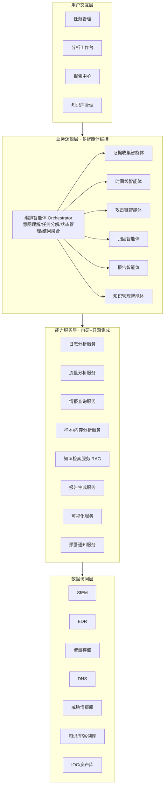
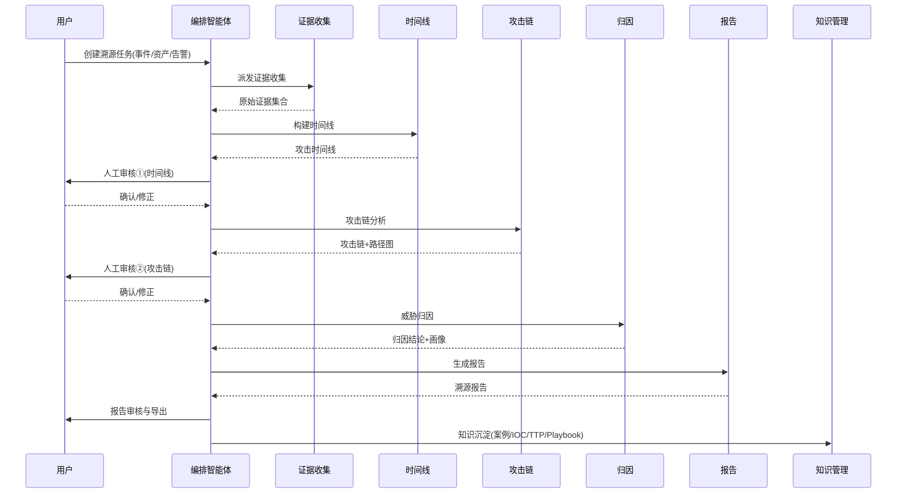
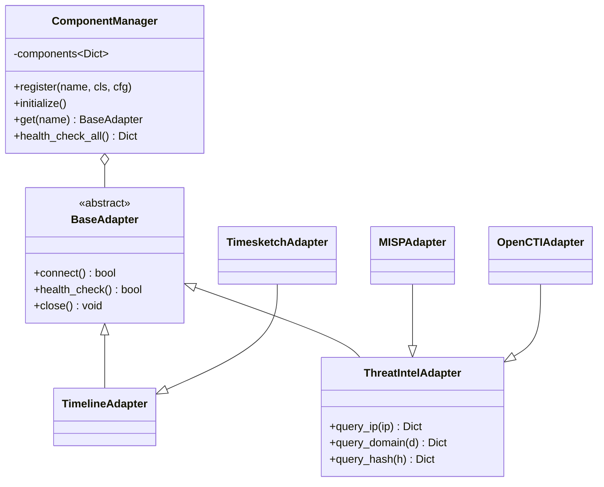
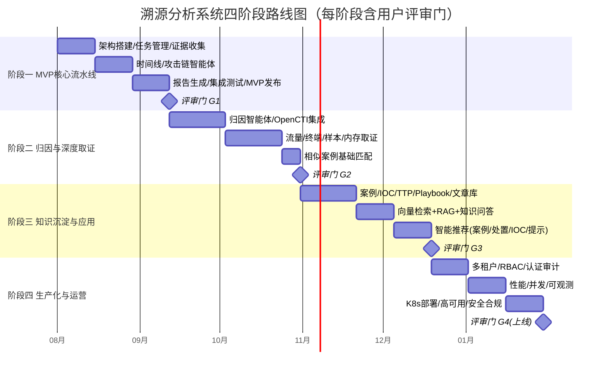

# 溯源分析系统 — 总体设计与四阶段路线图

> **版本**: v1.0  
> **日期**: 2026-07-21  
> **依据**: [traceback_system_prd.md](../traceback_system_prd.md) v1.2  
> **状态**: 待评审  
> **作者**: 架构组  
>  
> 本文档为系列设计文档的总纲，包含：①系统总体设计图；②四阶段实施路线图。  
> 各阶段技术设计文档见 `01_phase1_design.md` ~ `04_phase4_design.md`，逐阶段评审。

---

## 1. 设计目标与约束

### 1.1 核心目标（源自 PRD §1.3）

| 目标 | 指标 |
|------|------|
| 效率 | 平均溯源分析时间 < 30 分钟 |
| 质量 | 报告完整度评分 > 85 |
| 覆盖 | 覆盖 ≥ 80% 常见攻击场景（勒索/APT/数据泄露） |
| 可用 | 初级分析师可独立完成分析 |

### 1.2 关键约束

- **差异化定位**：深度溯源（攻击链还原 + AI 归因 + 置信度），非通用 SOC。
- **架构主线**：多智能体协同（7 个专业智能体 + 编排），自研编排与归因，集成成熟开源组件。
- **部署**：支持本地/私有云/混合部署，数据不出域。
- **License 合规**：AGPL/GPL 组件（MISP、Velociraptor、TheHive、Suricata）独立部署走 API，Apache/BSD 组件可深度集成。

### 1.3 自研 vs 集成边界（PRD §9.13.3）

| 模块 | 决策 |
|------|------|
| 智能体编排框架、攻击链还原、AI 归因、报告生成、知识检索/推荐 | **自研**（核心差异化） |
| 时间线可视化、威胁情报查询、流量/终端/日志/样本/内存取证 | **集成开源**（成熟方案） |

---

## 2. 系统总体设计

### 2.1 总体架构图（四层架构）

### 2.2 智能体协作时序图（端到端溯源流程）

### 2.3 技术栈选型

| 层次 | 技术选型 | 说明 |
|------|---------|------|
| 智能体编排 | LangGraph + LangChain | 状态机式多智能体编排，支持人工审核中断(resume) |
| API 服务 | FastAPI (Python 3.11+) | 异步、自带 OpenAPI 文档 |
| 大模型 | DeepSeek（可切换 Claude/Qwen） | 国产可控，支持私有化 |
| LLM 可观测 | LangSmith | 智能体调用链追踪与评测 |
| 关系数据库 | PostgreSQL | 任务/分析结果/处置方案库 |
| 文档数据库 | MongoDB | 时间线/知识案例/知识文章 |
| 向量数据库 | Milvus / pgvector | 相似案例检索、知识 RAG |
| 图数据库 | Neo4j（OpenCTI 内置） | IOC 关联、归因图谱 |
| 对象存储 | MinIO | 证据原始数据、PCAP、报告文件 |
| 搜索引擎 | Elasticsearch | Zeek/日志全文检索 |
| 消息队列 | Redis Streams / Celery | 异步任务、削峰 |
| 部署 | Docker + Kubernetes + Istio | 容器化、服务网格 |
| 可观测 | OpenTelemetry + Prometheus + Grafana | 日志/指标/链路 |

### 2.4 数据模型总览

PRD §6 已定义 9 个核心数据模型，按存储归属划分：

| 模型 | 存储 | 阶段 |
|------|------|------|
| TracebackTask 溯源任务 | PostgreSQL | P1 |
| Evidence 证据 | MinIO(原始)+MongoDB(元数据) | P1 |
| TimelineEvent 时间线事件 | MongoDB | P1 |
| AttackChain 攻击链 | PostgreSQL(JSONB) | P1 |
| AttributionResult 归因结果 | PostgreSQL | P2 |
| KnowledgeCase 知识案例 | MongoDB + Milvus(向量) | P3 |
| IOCKnowledge IOC知识 | Neo4j + PostgreSQL | P3 |
| ResponsePlaybook 处置方案 | PostgreSQL | P3 |
| KnowledgeArticle 知识文章 | MongoDB + Milvus | P3 |

### 2.5 统一集成适配器架构（PRD §9.16）

所有外部/开源组件通过适配器模式统一接入，组件管理器负责注册、健康检查、降级：

---

## 3. 四阶段实施路线图

PRD §10 仅详述第一阶段（MVP）。本路线图在 MVP 基础上向后延伸为四个阶段，遵循「先跑通端到端主流程 → 补深度归因与取证 → 建知识闭环 → 生产化与运营」的递进逻辑。

### 3.1 阶段总览对照表

| 阶段 | 主题 | 周期 | 核心交付 | 评审门 | 对应 PRD |
|------|------|------|---------|--------|---------|
| **P1** | MVP 核心溯源流水线 | ~6 周 | 任务管理→证据收集→时间线→攻击链→报告，端到端可跑通 | G1 | §10.1 |
| **P2** | 威胁归因与深度取证 | ~7 周 | 归因智能体+OpenCTI，流量/终端/样本/内存取证增强 | G2 | §4.2.5, §9.16 |
| **P3** | 知识沉淀与智能应用 | ~7 周 | 案例/IOC/TTP/Playbook/文章库 + RAG 检索 + 智能推荐 | G3 | §4.2.7, §4.2.8 |
| **P4** | 企业级生产化与运营 | ~6 周 | 多租户/RBAC、性能并发、可观测、K8s 高可用、安全合规 | G4 | §5, §9.16.5 |

### 3.2 各阶段范围边界

#### 阶段一 · MVP 核心溯源流水线
- **做**：基础架构、任务管理、证据收集智能体（SIEM/EDR/情报/MISP/Timesketch 基础对接）、时间线智能体+可视化、攻击链智能体+ATT&CK 标注、报告智能体（PDF/Word）、人工审核①②节点。
- **不做**：AI 归因（仅 IOC 简单匹配占位）、深度取证（Volatility/CAPE）、知识库、多租户、生产级高可用。
- **验收**：UAT-001 勒索病毒溯源端到端跑通，完整分析 < 30 分钟。

#### 阶段二 · 威胁归因与深度取证
- **做**：归因智能体（特征提取/情报匹配/置信度/攻击者画像）、OpenCTI 归因后端、Zeek+ES 流量深度分析、Velociraptor 终端取证、CAPE/YARA 样本、Volatility3 内存取证、相似历史案例基础向量匹配。
- **不做**：知识自动沉淀与推荐闭环（仅读取已有案例做匹配）。
- **验收**：UAT-002 APT 归因正确识别组织特征，TTP 标注准确率 > 80%。

#### 阶段三 · 知识沉淀与智能应用
- **做**：知识管理智能体、案例库（自动提取/编辑/分类/检索）、IOC/TTP/Playbook/文章库、向量数据库+RAG、相似案例推荐、处置方案推荐、IOC 自动匹配、分析提示、知识问答。
- **不做**：多租户隔离、生产级性能压测。
- **验收**：完成一次溯源后自动沉淀案例，新事件自动推荐相似案例与处置方案。

#### 阶段四 · 企业级生产化与运营
- **做**：多租户数据隔离、RBAC、LDAP/OAuth2、操作审计、性能优化（10 并发/100 万日志）、可观测三件套、K8s+Istio 部署、高可用(99.5%)/灾备、数据加密(TLS/AES-256)、License 合规审查、报告模板扩展、协作分析。
- **验收**：全部 NFR 指标达标，安全扫描无高危漏洞，UAT-001/002/003 通过。

### 3.3 评审门定义

每个阶段结束设评审门（G1~G4），**用户评审通过方可进入下一阶段**。评审材料：

1. 阶段技术设计文档（`0X_phaseX_design.md`）
2. 关键设计决策与取舍
3. 该阶段验收标准与测试方案
4. 风险与遗留问题

---

## 4. 设计文档索引

| 文档 | 内容 | 状态 |
|------|------|------|
| [00_overview_and_roadmap.md](00_overview_and_roadmap.md) | 总体设计 + 四阶段路线图（本文） | 待评审 |
| 01_phase1_design.md | 阶段一：MVP 核心溯源流水线技术设计 | 待编写 |
| 02_phase2_design.md | 阶段二：威胁归因与深度取证技术设计 | 待编写 |
| 03_phase3_design.md | 阶段三：知识沉淀与智能应用技术设计 | 待编写 |
| 04_phase4_design.md | 阶段四：企业级生产化与运营技术设计 | 待编写 |

---

## 5. 评审请求

请评审以下三点，确认后我据此逐阶段产出技术设计文档：

1. **四阶段划分与范围边界**（§3.2）是否合理？
2. **技术栈选型**（§2.3，DeepSeek/LangGraph/FastAPI/PG+Mongo+Milvus+Neo4j/MinIO/ES）是否符合团队现状？
3. **评审门机制**（每阶段产出设计文档后用户评审，通过再进入下一阶段）是否按此执行？
