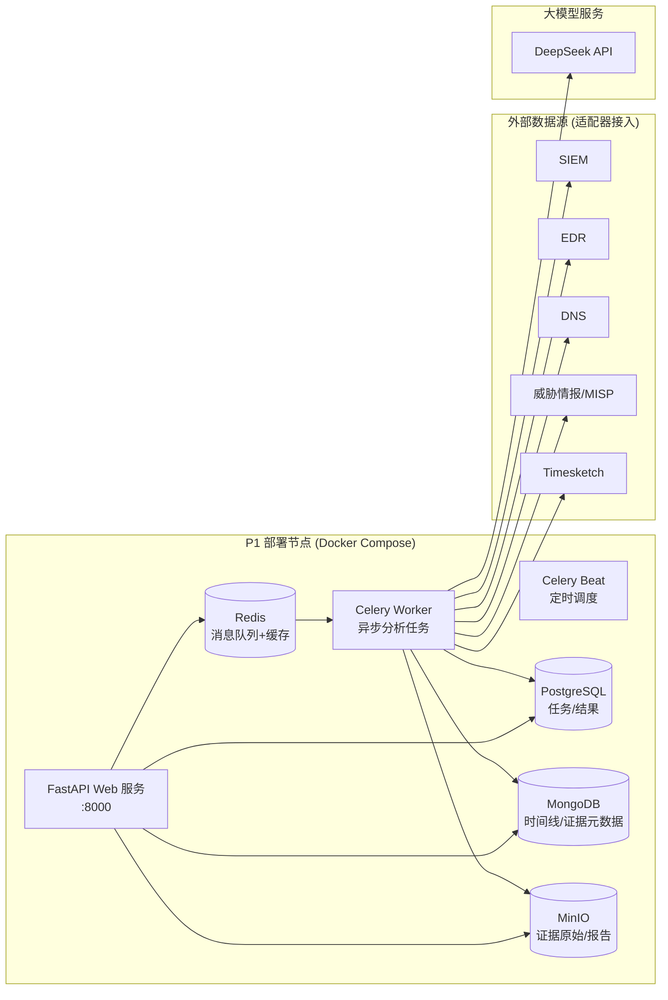
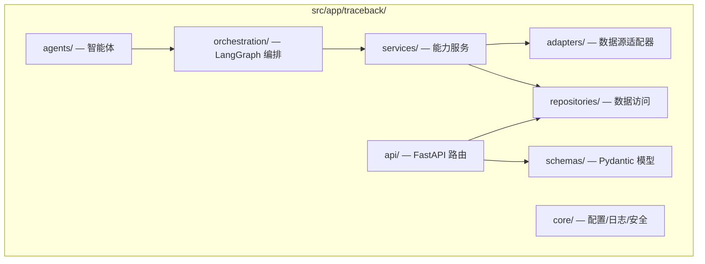
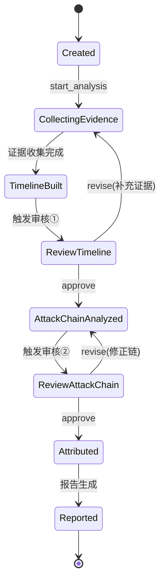
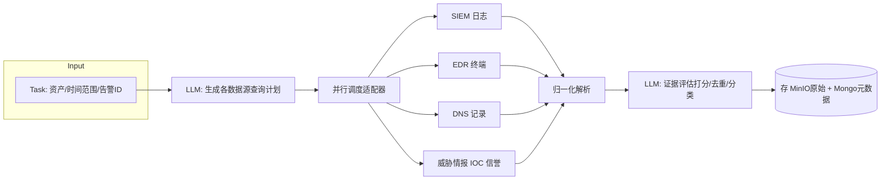
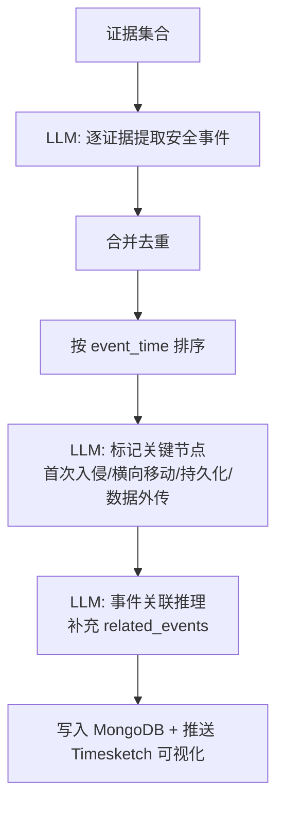
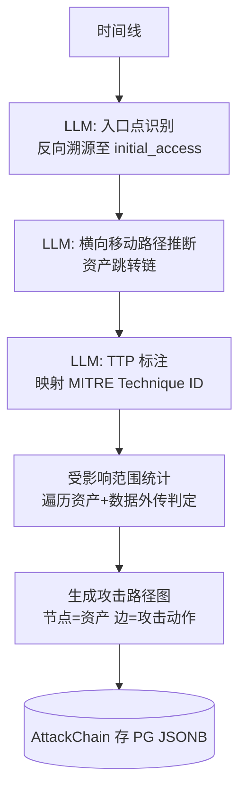
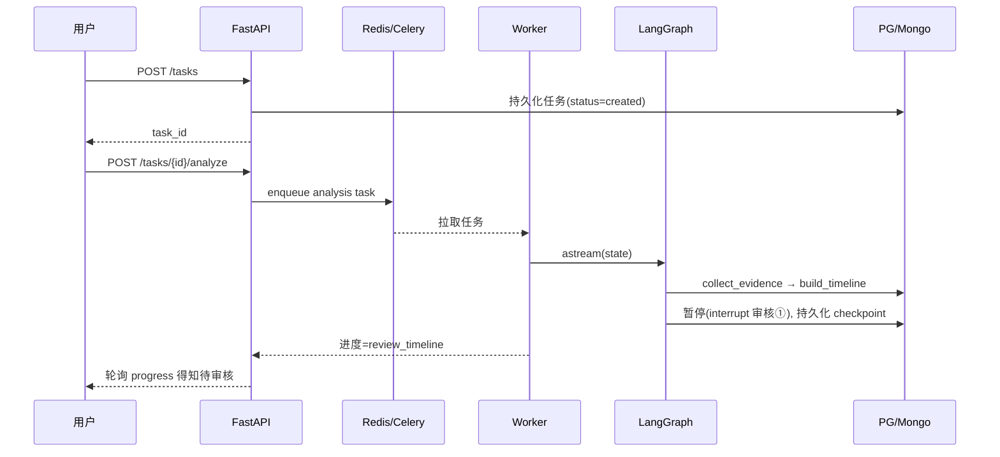
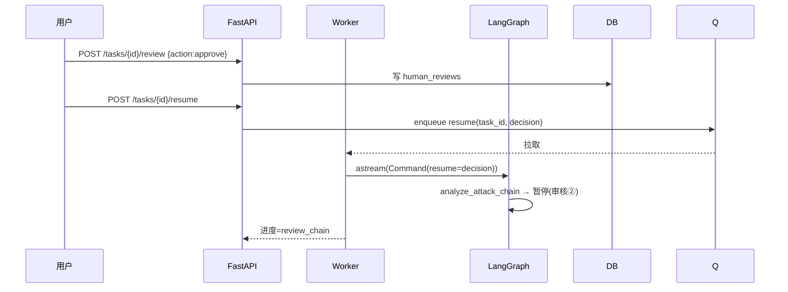

# 阶段一技术设计 — MVP 核心溯源流水线

> **阶段**: P1 · MVP 核心溯源流水线  
> **版本**: v1.0  
> **日期**: 2026-07-21  
> **依据**: [00_overview_and_roadmap.md](00_overview_and_roadmap.md)、[traceback_system_prd.md](../traceback_system_prd.md) §10.1  
> **状态**: 待评审（评审门 G1）  
>  
> 通过本阶段交付端到端最小可用溯源流程：任务管理 → 证据收集 → 时间线 → 攻击链 → 报告，含人工审核①②节点。

---

## 1. 阶段目标与范围

### 1.1 目标

打通「输入安全事件 → 自动溯源 → 输出报告」的最小闭环，验证多智能体编排架构可行性与溯源深度差异化。

### 1.2 范围边界

| 类型 | 内容 |
|------|------|
| **做** | 基础架构搭建；任务管理（创建/查询/详情/关联告警/指定资产）；证据收集智能体（SIEM 日志、EDR 终端、威胁情报、DNS 四类数据源 + MISP/Timesketch 基础对接）；时间线智能体（事件提取/排序/关键节点标记/可视化）；攻击链智能体（入口点识别/横向移动/TTP 标注/路径图）；报告智能体（简报+详报模板、PDF/Word/Markdown 导出）；人工审核①（时间线）与②（攻击链）中断-恢复机制。 |
| **不做（推迟）** | AI 深度归因（P2，本阶段仅 IOC 简单匹配占位）；Volatility/CAPE 内存与样本取证（P2）；知识库自动沉淀与推荐（P3）；多租户/RBAC/高可用/K8s（P4）。 |
| **占位实现** | 归因智能体在 P1 提供桩接口（输出 IOC 命中清单 + 置信度 0），保证流水线结构完整、P2 可平滑替换。 |

### 1.3 验收标准（对应 PRD §8）

| 项 | 标准 | 方式 |
|----|------|------|
| 任务创建 | 响应 < 2s，自动关联告警与资产 | 功能测试 |
| 证据收集 | ≥ 3 种数据源，证据完整可追溯，< 5 分钟（10 万日志） | 功能+性能 |
| 时间线构建 | 自动构建，关键事件标记准确，< 3 分钟 | 功能+专家评审 |
| 攻击链还原 | 还原入口与传播路径，TTP 标注准确率 > 80% | 功能+专家评审 |
| 报告生成 | 完整报告，PDF/Word 格式正确 | 功能测试 |
| 人工审核 | 关键节点可审核修正，操作记录可追溯 | 功能测试 |
| 端到端 | UAT-001 勒索病毒溯源完整分析 < 30 分钟 | UAT |

---

## 2. 系统架构

### 2.1 P1 部署架构

P1 采用**单机/Docker Compose**部署，不引入 K8s（P4 再上），聚焦功能验证。



### 2.2 模块划分



### 2.3 目录结构

```
src/app/traceback/
├── api/
│   ├── v1/
│   │   ├── tasks.py            # 任务管理接口
│   │   ├── analysis.py         # 分析控制/审核接口
│   │   └── results.py          # 结果查询接口
│   └── deps.py                 # 依赖注入
├── schemas/
│   ├── task.py                 # TracebackTask
│   ├── evidence.py             # Evidence
│   ├── timeline.py             # TimelineEvent
│   ├── attack_chain.py         # AttackChain
│   └── review.py               # HumanReview
├── agents/
│   ├── base.py                 # AgentBase 抽象
│   ├── orchestrator.py         # 编排智能体
│   ├── evidence_collector.py   # 证据收集智能体
│   ├── timeline_builder.py     # 时间线智能体
│   ├── attack_chain.py         # 攻击链智能体
│   ├── attribution.py          # 归因智能体(P1桩)
│   └── reporter.py             # 报告智能体
├── orchestration/
│   ├── graph.py                # LangGraph 状态图定义
│   ├── state.py                # 全局状态 TypedDict
│   └── nodes.py                # 图节点封装
├── services/
│   ├── log_analysis.py
│   ├── traffic_analysis.py
│   ├── threat_intel.py
│   ├── timeline_service.py
│   ├── attack_chain_service.py
│   └── report_service.py
├── adapters/
│   ├── base.py                 # BaseAdapter
│   ├── siem_adapter.py
│   ├── edr_adapter.py
│   ├── dns_adapter.py
│   ├── misp_adapter.py
│   ├── timesketch_adapter.py
│   └── manager.py              # ComponentManager
├── repositories/
│   ├── task_repo.py
│   ├── evidence_repo.py
│   ├── timeline_repo.py
│   └── attack_chain_repo.py
├── core/
│   ├── config.py
│   ├── logging.py
│   ├── llm.py                  # LLM 客户端封装
│   └── db.py                   # 异步会话
├── templates/
│   ├── report_brief.md.j2
│   ├── report_detail.md.j2
│   └── report_technical.md.j2
└── main.py
```

---

## 3. 智能体编排设计（LangGraph）

### 3.1 编排状态机

P1 用 LangGraph 构建状态机，关键点是**人工审核节点使用 `interrupt`**，实现暂停-恢复。状态机节点：`create → collect_evidence → build_timeline → [审核①] → analyze_attack_chain → [审核②] → attribute → report → sinknowledge`。



### 3.2 全局状态定义

```python
# orchestration/state.py
from typing import TypedDict, Literal, Annotated
from operator import add

class TracebackState(TypedDict):
    task_id: str
    task: dict                       # TracebackTask 快照
    evidence_ids: Annotated[list[str], add]   # 累积证据ID
    timeline_events: list[dict]      # TimelineEvent[]
    attack_chain: dict | None        # AttackChain
    attribution: dict | None         # AttributionResult (P1桩)
    report_path: str | None
    stage: Literal[
        "created", "collecting", "timeline_built",
        "review_timeline", "chain_analyzed",
        "review_chain", "attributed", "reported"
    ]
    errors: Annotated[list[str], add]
    human_reviews: Annotated[list[dict], add]
```

### 3.3 智能体基类与契约

```python
# agents/base.py
from abc import ABC, abstractmethod

class AgentBase(ABC):
    name: str

    @abstractmethod
    async def run(self, state: TracebackState) -> dict:
        """执行智能体逻辑，返回状态增量(partial state)。

        约定：返回的 dict 键须为 TracebackState 子集，
        LangGraph 会做 reducer 合并。
        """
        ...
```

| 智能体 | 输入 | 输出（状态增量） | LLM 用途 |
|--------|------|------------------|---------|
| Orchestrator | task | stage 推进指令 | 任务分解规划 |
| EvidenceCollector | task.evidence_query | evidence_ids | 查询构建、证据筛选评估 |
| TimelineBuilder | evidence_ids | timeline_events | 事件提取、关联推理、关键节点标记 |
| AttackChainAgent | timeline_events | attack_chain | 入口识别、横向移动推理、TTP 标注 |
| Attribution(P1桩) | attack_chain | attribution | 仅 IOC 命中汇总，置信度 0 |
| Reporter | 全部结果 | report_path | 报告内容组织与润色 |

### 3.4 人工审核中断-恢复机制

LangGraph 的 `interrupt` + `Command(resume=...)` 实现：

```python
# orchestration/graph.py (节选)
from langgraph.graph import StateGraph, END
from langgraph.types import interrupt, Command

def review_timeline_node(state: TracebackState) -> TracebackState:
    decision = interrupt({
        "stage": "timeline",
        "timeline": state["timeline_events"],
        "prompt": "请审核时间线，approve 或 revise"
    })
    # 恢复时由 API 注入 decision: {action, comments, modifications}
    if decision["action"] == "revise":
        return {"stage": "collecting", "human_reviews": [decision]}
    return {"stage": "chain_analyzed", "human_reviews": [decision]}
```

恢复入口在 API 层：`POST /tasks/{id}/resume`，携带审核结果，调用 `graph.astream(Command(resume=decision), config={...})`。任务状态持久化到 PostgreSQL，进程重启后可重新加载 checkpoint 恢复。

---

## 4. 智能体详细设计

### 4.1 证据收集智能体



**关键设计**：
- **查询计划**：LLM 根据资产与时间范围生成每个数据源的查询 DSL（SIEM 的 Lucene、EDR 的过滤条件等），结构化输出经校验后执行，防注入。
- **并行收集**：`asyncio.gather` 并发调用适配器，单源超时 60s 降级不阻塞整体。
- **证据评估**：LLM 对每条证据打 `importance`(high/medium/low)、`tags`、`related_assets`；高重要性证据优先送入时间线。
- **去重**：按 `(source, raw_hash)` 去重，避免重复存储。

**证据存储分离**：原始大字段（PCAP、日志原文）入 MinIO，结构化元数据入 MongoDB，PG 只存 `evidence_id` 引用，避免 PG 膨胀。

### 4.2 时间线智能体



**关键事件类型枚举**（对齐 MITRE ATT&CK 战术）：`initial_access, execution, persistence, privilege_escalation, defense_evasion, credential_access, discovery, lateral_movement, collection, exfiltration, impact`。

**Timesketch 集成**（PRD §9.16.2-A）：通过 `TimesketchAdapter` 创建 sketch、上传 JSONL 事件、返回 sketch URL 供前端 iframe 嵌入可视化。P1 仅做基础集成，缩放/筛选用 Timesketch 原生能力。

### 4.3 攻击链智能体



**TTP 标注准确率保障**：
- LLM 输出强制约束为 `[{event_id, tactic, technique_id, confidence}]`，`technique_id` 须命中预置的 ATT&CK ID 白名单（本地加载 attack-azure/enterprise JSON），未命中则标记 `unknown` 并降置信。
- 入口点识别采用「反向溯源」：从最高 severity 事件（如 impact/勒索加密）回溯到最早的 initial_access 事件，LLM 推理因果链。

**攻击路径图**：节点=资产(IP/主机)，边=攻击动作(带 technique_id 标签)，用 Graphviz/Cytoscape 渲染为 SVG 嵌入报告。数据结构：

```python
attack_path_graph = {
    "nodes": [{"id": "192.168.1.100", "type": "victim"}, ...],
    "edges": [{"from": "...", "to": "...", "technique": "T1021.001", "label": "RDP横向"}]
}
```

### 4.4 报告智能体

**模板**（Jinja2 + Markdown）：`report_brief.md.j2`（简报，1 页）、`report_detail.md.j2`（详报，含时间线表+攻击链图+归因+处置建议）、`report_technical.md.j2`（技术报告，含原始证据索引）。

**生成流程**：
1. Reporter 智能体用 LLM 生成各章节叙事文本（事件概述、攻击链叙述、处置建议）。
2. 结构化数据（时间线表、IOC 清单、TTP 矩阵）由模板直接渲染，不交 LLM，避免幻觉。
3. 攻击路径 SVG 作为图片插入。
4. **格式转换**：Markdown → PDF（`md2pdf`/`weasyprint`）、→ Word（`pandoc`）。
5. 报告文件存 MinIO，记录 `report_path`。

---

## 5. 数据模型与存储设计

### 5.1 PostgreSQL Schema（P1 核心）

```sql
-- 溯源任务
CREATE TABLE traceback_tasks (
    task_id          TEXT PRIMARY KEY,
    task_name        TEXT NOT NULL,
    description      TEXT,
    status           TEXT NOT NULL,          -- created/analyzing/reviewing/done/failed
    current_stage    TEXT NOT NULL,
    alert_ids        JSONB NOT NULL DEFAULT '[]',
    asset_ips        JSONB NOT NULL DEFAULT '[]',
    asset_hosts      JSONB NOT NULL DEFAULT '[]',
    asset_users      JSONB NOT NULL DEFAULT '[]',
    event_start_time TIMESTAMPTZ,
    event_end_time   TIMESTAMPTZ,
    assignee         TEXT,
    retry_count      INT DEFAULT 0,
    error_message    TEXT,
    create_time      TIMESTAMPTZ NOT NULL DEFAULT now(),
    update_time      TIMESTAMPTZ NOT NULL DEFAULT now()
);
CREATE INDEX idx_tasks_status ON traceback_tasks(status);

-- 证据引用(PG 只存轻量引用)
CREATE TABLE evidences (
    evidence_id   TEXT PRIMARY KEY,
    task_id       TEXT NOT NULL REFERENCES traceback_tasks(task_id),
    evidence_type TEXT NOT NULL,             -- log/traffic/intel/dns/sample
    source        TEXT NOT NULL,
    importance    TEXT NOT NULL,
    tags          JSONB DEFAULT '[]',
    object_key    TEXT NOT NULL,             -- MinIO 对象 key
    meta_id       TEXT NOT NULL,             -- MongoDB 文档 id
    collect_time  TIMESTAMPTZ NOT NULL DEFAULT now()
);
CREATE INDEX idx_evid_task ON evidences(task_id);

-- 攻击链(JSONB)
CREATE TABLE attack_chains (
    chain_id    TEXT PRIMARY KEY,
    task_id     TEXT UNIQUE NOT NULL REFERENCES traceback_tasks(task_id),
    payload     JSONB NOT NULL,              -- AttackChain 完整结构
    create_time TIMESTAMPTZ NOT NULL DEFAULT now()
);

-- 归因(P1 桩)
CREATE TABLE attributions (
    attribution_id TEXT PRIMARY KEY,
    task_id        TEXT UNIQUE NOT NULL REFERENCES traceback_tasks(task_id),
    attributed     BOOLEAN DEFAULT FALSE,
    confidence     REAL DEFAULT 0,
    matched_iocs   JSONB DEFAULT '[]',
    payload        JSONB
);

-- 人工审核记录
CREATE TABLE human_reviews (
    review_id     TEXT PRIMARY KEY,
    task_id       TEXT NOT NULL REFERENCES traceback_tasks(task_id),
    stage         TEXT NOT NULL,             -- timeline/attack_chain/report
    action        TEXT NOT NULL,             -- approve/revise
    reviewer      TEXT NOT NULL,
    comments      TEXT,
    modifications JSONB DEFAULT '[]',
    review_time   TIMESTAMPTZ NOT NULL DEFAULT now()
);

-- LangGraph checkpoint(用于中断恢复)
CREATE TABLE langgraph_checkpoints (
    thread_id TEXT NOT NULL,
    checkpoint JSONB NOT NULL,
    update_time TIMESTAMPTZ NOT NULL DEFAULT now(),
    PRIMARY KEY (thread_id)
);
```

> P1 不做多租户，所有表暂不加 `tenant_id`，P4 统一补。

### 5.2 MongoDB Collections

| Collection | 文档内容 | 索引 |
|-----------|---------|------|
| `evidence_meta` | Evidence.parsed_data、raw_data 摘要、related_assets | `task_id` |
| `timeline_events` | TimelineEvent 完整结构 | `task_id`、`task_id+event_time` |

### 5.3 MinIO Bucket

| Bucket | 内容 | 保留 |
|--------|------|------|
| `evidence-raw` | 日志原文、PCAP、样本 | 1 年 |
| `reports` | 生成的 PDF/Word/MD 报告 | 3 年 |

---

## 6. API 设计（P1）

### 6.1 任务管理

| 方法 | 路径 | 说明 |
|------|------|------|
| POST | `/api/v1/traceback/tasks` | 创建任务（US-001） |
| GET | `/api/v1/traceback/tasks` | 任务列表（筛选排序） |
| GET | `/api/v1/traceback/tasks/{id}` | 任务详情 |
| PUT | `/api/v1/traceback/tasks/{id}` | 更新任务 |
| DELETE | `/api/v1/traceback/tasks/{id}` | 取消任务 |

### 6.2 分析控制

| 方法 | 路径 | 说明 |
|------|------|------|
| POST | `/api/v1/traceback/tasks/{id}/analyze` | 开始分析（入队 Celery） |
| GET | `/api/v1/traceback/tasks/{id}/progress` | 分析进度（stage + 进度百分比） |
| POST | `/api/v1/traceback/tasks/{id}/review` | 提交人工审核（approve/revise + 修改） |
| POST | `/api/v1/traceback/tasks/{id}/resume` | 恢复被中断的分析 |

### 6.3 结果查询

| 方法 | 路径 | 说明 |
|------|------|------|
| GET | `/api/v1/traceback/tasks/{id}/timeline` | 时间线事件 |
| GET | `/api/v1/traceback/tasks/{id}/attack-chain` | 攻击链 + 路径图 |
| GET | `/api/v1/traceback/tasks/{id}/report?format=pdf\|word\|md` | 报告下载 |

请求/响应结构遵循 PRD §7.1。所有 API 走 FastAPI 自动生成 OpenAPI（`/docs`）。

### 6.4 错误模型

统一错误响应 `{code, message, detail}`，code 用 `TB-1xxx` 段（P1：1001 任务不存在、1002 状态非法、1003 数据源不可达、1004 审核参数错误）。

---

## 7. 数据源适配器设计

### 7.1 适配器接口（PRD §9.16.3）

P1 落地 5 个适配器，全部继承 `BaseAdapter`，由 `ComponentManager` 统一注册、健康检查、降级。

```python
# adapters/base.py
class BaseAdapter(ABC):
    @abstractmethod
    async def connect(self) -> bool: ...
    @abstractmethod
    async def health_check(self) -> bool: ...
    @abstractmethod
    async def close(self) -> None: ...
```

### 7.2 P1 适配器清单

| 适配器 | 数据源 | 集成方式 | P1 实现范围 |
|--------|--------|---------|------------|
| `SIEMAdapter` | SIEM（Wazuh/OpenSearch） | REST/Elasticsearch DSL | 按资产+时间查日志 |
| `EDRAdapter` | EDR | REST | 终端进程/网络行为 |
| `DNSAdapter` | DNS 服务 | REST | 解析记录查询 |
| `MISPAdapter` | MISP | REST（pymisp） | IP/域名/Hash 信誉 |
| `TimesketchAdapter` | Timesketch | REST | 时间线可视化（写入+查询） |

### 7.3 降级策略

任一适配器 `health_check` 失败或查询超时：记录 `errors`、该源证据标记为 `unavailable`，不中断整体流程。证据收集报告显式标注缺失源，提示人工补查。

---

## 8. LLM 调用与提示工程

### 8.1 统一封装

```python
# core/llm.py
class LLMClient:
    def __init__(self, model: str = "deepseek-chat"):
        self.model = model
    async def complete(self, messages, schema: type | None = None) -> dict | str:
        # 支持 structured output(JSON schema 强约束)
        ...
```

### 8.2 提示设计原则

- **结构化输出优先**：事件提取、TTP 标注、查询计划等均用 JSON schema 约束，校验失败重试（最多 2 次）。
- **防注入**：数据源原始日志作为 user message 的引用块，系统提示固定；查询 DSL 经白名单字段校验后才执行。
- **上下文裁剪**：单次证据量大时，按 importance 分批送入 LLM，避免超 token；时间线构建采用 map-reduce（分证据提取→合并）。

### 8.3 P1 LLM 调用清单

| 智能体 | 调用点 | 输出 schema |
|--------|--------|------------|
| EvidenceCollector | 查询计划生成、证据评估 | QueryPlan、EvidenceScore[] |
| TimelineBuilder | 事件提取、关键节点标记、关联推理 | TimelineEvent[]、KeyEventMarks |
| AttackChainAgent | 入口识别、横向移动、TTP 标注 | EntryPoint、LateralPath[]、TTPMatch[] |
| Reporter | 章节叙事生成 | ReportSections |

---

## 9. 关键流程时序

### 9.1 创建并启动分析



### 9.2 人工审核恢复



---

## 10. 非功能性设计（P1 最低要求）

| 维度 | P1 要求 | 实现 |
|------|---------|------|
| 性能 | 完整分析 < 30min；任务创建 < 2s；证据收集 < 5min | 异步 Celery、并行适配器、LLM 分批 |
| 可用性 | 单机稳定运行，故障可恢复 | checkpoint 持久化，Worker 重启可恢复 |
| 可观测 | 日志 + 基本指标 | structlog 结构化日志；Prometheus `/metrics`（任务计数、阶段耗时） |
| 安全 | 基础认证（单用户 Token）| API Token 中间件；P4 再上 RBAC/LDAP |
| 数据持久 | 分析过程不丢失 | PG + checkpoint 双写 |

P1 不做：多租户、99.5% 高可用、K8s、链路追踪（OpenTelemetry 留 P4）。

---

## 11. 测试策略

| 层次 | 范围 | 工具 |
|------|------|------|
| 单元 | 适配器、服务、智能体逻辑（LLM mock） | pytest + pytest-asyncio，覆盖率 > 80% |
| 集成 | API→Worker→DB 全链路（LLM 用录 fixture） | pytest + testcontainers(PG/Mongo/MinIO/Redis) |
| 端到端 | UAT-001 勒索病毒溯源 | 预置样本数据集，断言报告完整度 |
| LLM 评测 | TTP 标注准确率 > 80% | 标注 20 条黄金样本，LangSmith 评测集 |

---

## 12. 里程碑与交付物（对齐 PRD §10.1）

| Sprint | 里程碑 | 交付物 | 完成标准 |
|--------|--------|--------|---------|
| S1 (W1-2) | M1 基础架构 | Docker Compose 环境、PG/Mongo/MinIO/Redis、LLM 封装、智能体框架基座 | 环境起得来，骨架单测通过 |
| S2 (W3-4) | M2 任务管理+证据收集 | 任务 API、5 个适配器、证据收集智能体 | 3 源证据可收集，接口测试通过 |
| S3 (W5-6) | M3 时间线+攻击链 | 时间线/攻击链智能体、Timesketch 集成、路径图 | TTP 标注准确率 > 80% |
| S4 (W7-8) | M4 报告+集成+MVP | 报告智能体、人工审核恢复、UAT-001 通过 | **G1 评审门：MVP 发布** |

---

## 13. 风险与对策（P1 相关，源自 PRD §12）

| 风险 | P1 影响 | 对策 |
|------|---------|------|
| TR-001 LLM 结果不稳定 | 高 | JSON schema 约束 + 重试 + 人工审核兜底 |
| TR-002 数据源接口兼容 | 中 | 适配器抽象 + 降级；P1 先对接 1 套真实 SIEM/EDR，其余 mock |
| TR-003 大数据性能 | 中 | 证据分批、按 importance 裁剪；P1 限 10 万日志 |
| TR-004 智能体协同复杂 | 中 | LangGraph 状态机显式化，checkpoint 可恢复 |
| BR-001 准确率不达标 | 高 | 黄金样本评测 + 提示迭代；TTP 白名单约束 |

---

## 14. 评审检查清单（G1）

请重点评审：

1. **范围边界**：归因智能体在 P1 用桩接口、深度取证推迟到 P2，是否可接受？
2. **编排选型**：LangGraph 状态机 + interrupt 实现人工审核中断-恢复，是否符合预期？
3. **存储拆分**：原始数据 MinIO、元数据 Mongo、引用 PG 的三段式，是否合理？
4. **数据源范围**：P1 对接 SIEM/EDR/DNS/MISP/Timesketch 5 个适配器，其余 mock，是否合适？
5. **TTP 标注**：用 ATT&CK ID 白名单约束 + 黄金样本评测保障 > 80% 准确率，是否认可？
6. **部署**：P1 用 Docker Compose 单机、不上 K8s，是否同意？

确认后进入阶段二设计（归因与深度取证）。
