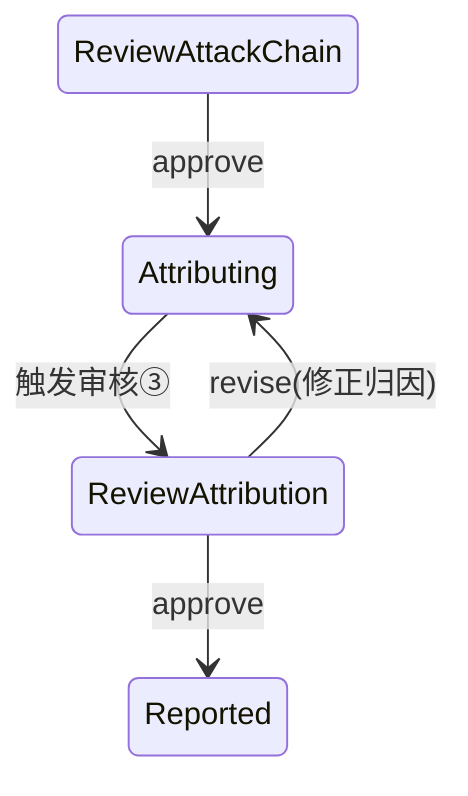
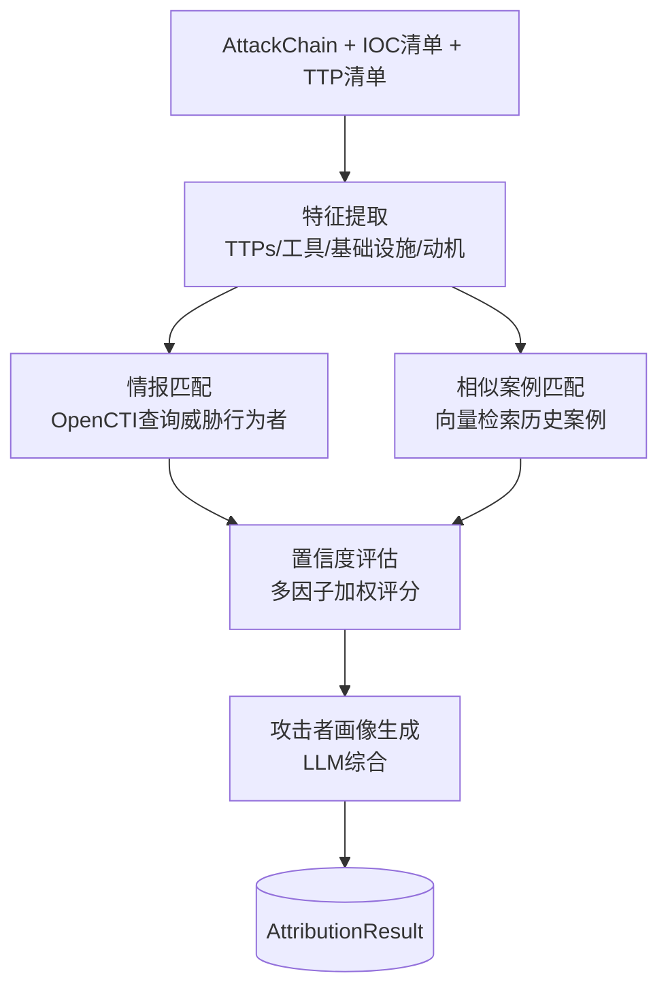
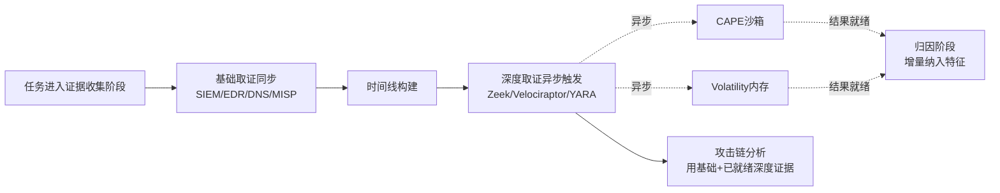

# 阶段二技术设计 — 威胁归因与深度取证

> **阶段**: P2 · 威胁归因与深度取证  
> **版本**: v1.0  
> **日期**: 2026-07-22  
> **依据**: [00_overview_and_roadmap.md](00_overview_and_roadmap.md)、[01_phase1_design.md](01_phase1_design.md)、[traceback_system_prd.md](../traceback_system_prd.md) §4.2.5、§9.16  
> **状态**: 待评审（评审门 G2）  
>  
> 本阶段替换 P1 归因桩为完整 AI 归因智能体，并补齐流量/终端/样本/内存四类深度取证，使溯源从「能跑通」到「有深度」。

---

## 1. 阶段目标与范围

### 1.1 目标

1. **归因能力落地**：将 P1 的归因桩升级为完整归因智能体，输出威胁组织匹配、置信度评分、攻击者画像。
2. **深度取证增强**：补齐 P1 缺失的流量深度分析、终端取证、样本分析、内存取证四类能力，证据维度从 4 类扩展到 8 类。
3. **相似案例基础匹配**：基于已有历史案例做向量相似匹配，为归因提供旁证（P3 再做知识闭环）。

### 1.2 范围边界

| 类型 | 内容 |
|------|------|
| **做** | 归因智能体（特征提取/情报匹配/置信度/攻击者画像）；OpenCTI GraphQL 集成（归因后端）；Zeek+ES 流量深度分析适配器；Velociraptor 终端取证适配器；CAPE+YARA 样本分析适配器；Volatility3 内存取证适配器；相似历史案例向量匹配（只读消费 P3 案例库，P2 用预置种子案例）；归因审核节点（新增人工审核③）。 |
| **不做（推迟）** | 知识库自动沉淀与推荐闭环（P3）；多租户与生产化（P4）；攻击模拟 F-004-07（P4/后续）。 |
| **依赖前置** | P1 已交付的 LangGraph 编排框架、适配器抽象、三段式存储。 |

### 1.3 验收标准

| 项 | 标准 | 方式 |
|----|------|------|
| 威胁归因 | 关联威胁情报，归因结果有置信度评分，UAT-002 APT 正确识别组织特征 | 功能+专家评审 |
| 深度取证 | 流量/终端/样本/内存四类适配器可用，至少 2 类在 UAT 场景产出有效证据 | 功能测试 |
| 归因置信度 | Top1 归因准确率 > 70%（黄金样本集） | LLM 评测 |
| 性能 | 归因阶段 < 5 分钟；深度取证不拖垮整体 < 30min（取证可异步并行） | 性能测试 |
| 人工审核 | 新增归因审核③节点，可修正归因结论 | 功能测试 |

---

## 2. 与 P1 的衔接与变更

### 2.1 编排状态机扩展

在 P1 状态机 `Attributed` 节点前后插入审核③，并细化归因内部子流程：



`TracebackState` 增量字段：

```python
class TracebackState(TypedDict):
    # ... P1 字段 ...
    attribution: dict | None          # 由桩升级为完整 AttributionResult
    deep_evidence_ids: Annotated[list[str], add]  # 深度取证产出证据
    similar_cases: list[dict]         # 相似案例匹配结果
    stage: Literal[..., "attributing", "review_attribution", "reported"]
```

### 2.2 归因桩替换

P1 的 `AttributionAgent` 桩（输出 IOC 命中清单 + 置信度 0）由 P2 完整实现替换，对外接口 `run(state) -> {attribution, similar_cases}` 不变，P1 调用方零改动。

### 2.3 适配器注册扩展

`ComponentManager` 新增注册 4 个深度取证适配器 + OpenCTI 归因适配器，P1 的 5 个适配器保持不变。

---

## 3. 归因智能体详细设计

### 3.1 归因流程



### 3.2 特征提取

从 AttackChain 与证据中提取四类归因特征：

| 特征类 | 来源 | 用途 |
|--------|------|------|
| TTPs | 攻击链 technique_id 集合 | 与 OpenCTI 威胁行为者的 attackPatterns 比对 |
| 工具 | 证据中提取的攻击工具名（Cobalt Strike、Mimikatz 等） | 工具指纹匹配 |
| 基础设施 | attacker_ips、attacker_domains、C2 特征 | IOC 关联威胁组织 |
| 动机 | 攻击目标行业、勒索赎金、数据类型 | 推断 primary_motivation |

输出结构化 `ActorFeatures`，送入情报匹配与相似案例匹配。

### 3.3 OpenCTI 归因后端集成（PRD §9.16.2-B）

新增 `OpenCTIAdapter`（继承 `ThreatIntelAdapter`），通过 GraphQL 查询：

```python
class OpenCTIAttributionAdapter:
    async def search_by_ioc(self, value, ioc_type) -> list[dict]:
        """IOC → 关联 threatActors"""

    async def search_threat_actor(self, name) -> dict | None:
        """按名称查威胁行为者画像"""

    async def get_attack_patterns(self, threat_actor_id) -> list[dict]:
        """威胁行为者 → 使用过的 attackPatterns(含 x_mitre_id)"""

    async def get_campaigns(self, threat_actor_id) -> list[dict]:
        """威胁行为者 → 关联攻击活动"""
```

**归因匹配算法**（TTP 重叠度 + IOC 命中 + 工具重叠）：

```
对每个候选威胁组织 c:
  score_ttp  = |事件TTP ∩ c.attackPatterns| / |事件TTP|        (权重 0.5)
  score_ioc  = 命中 c 关联 IOC 数 / 事件 IOC 总数                (权重 0.3)
  score_tool = |事件工具 ∩ c.tools| / |事件工具|                (权重 0.2)
  confidence_c = 100 * (0.5*score_ttp + 0.3*score_ioc + 0.2*score_tool)
取 Top3 候选，confidence 最高者为归因结论。
```

### 3.4 相似案例匹配（基础版）

P2 案例库尚未自动沉淀（P3 做），采用**预置种子案例 + 向量检索**：

- 预置 30~50 个公开溯源案例（勒索/APT/数据泄露）入库 Milvus，embedding 由 `attack_type + TTPs + IOC 类型` 组合文本生成。
- 归因时用当前事件特征生成 query embedding，检索 Top-K 相似案例作为归因旁证。
- 匹配结果写入 `AttributionResult.similar_cases`，P3 案例库建成后无缝替换种子数据。

### 3.5 攻击者画像

LLM 综合归因结果生成画像：组织名称、背景、 sophistication、动机、历史攻击活动、典型 TTPs、本次匹配依据。结构对齐 PRD §6.2.5 `ActorProfile`。

### 3.6 归因结果模型（PRD §6.2.5）

```python
class AttributionResult(TypedDict):
    attribution_id: str
    task_id: str
    attributed: bool
    threat_actor: str | None
    confidence_score: float          # 0-100
    matched_iocs: list[dict]
    matched_ttps: list[dict]
    matched_campaigns: list[str]
    similar_cases: list[dict]
    actor_profile: dict | None
    candidates: list[dict]           # Top3 候选 + 各自分数，供审核修正
```

PG `attributions` 表的 `payload` JSONB 存完整结构，`confidence`、`attributed` 字段冗余便于查询。

---

## 4. 深度取证适配器设计

### 4.1 流量深度分析 — Zeek + Elasticsearch（PRD §9.16.2-D）

新增 `ZeekDeepAdapter`，区别于 P1 的流量基础查询，做深度事件提取：

| 能力 | 实现 |
|------|------|
| 连接日志分析 | `conn.log` → 提取异常外联、C2 信标（固定间隔连接） |
| DNS 分析 | `dns.log` → DGA 检测、DNS 隧道、Fast Flux |
| HTTP 分析 | `http.log` → 可疑 UA、恶意 URL、C2 通信 |
| 文件传输 | `files.log` → 提取传输文件 hash 送样本分析 |

集成链路：Zeek 探针 → Filebeat → Elasticsearch → 适配器 DSL 查询。P2 复用 P1 `SIEMAdapter` 的 ES 客户端，扩展查询方法。

### 4.2 终端取证 — Velociraptor（PRD §9.16.2-H）

新增 `VelociraptorAdapter`（REST API）：

| Artifact | 用途 |
|----------|------|
| `Windows.System.Pslist` | 进程列表 + 异常进程识别 |
| `Windows.Network.Netstat` | 网络连接 + C2 连接定位 |
| `Windows.Detection.Yara.NTFS` | 终端文件 YARA 扫描 |
| `Windows.Registry.NTUser` | 持久化注册表项 |

异步收集：`collect_artifact` 创建 hunt → 轮询结果（最长 5 分钟）→ 解析为 Evidence。

### 4.3 样本分析 — CAPE + YARA（PRD §9.16.2-F）

新增 `CAPEAdapter`（REST 提交样本）+ `YARAAdapter`（Python SDK）：

- **YARA**：本地规则库扫描证据文件/内存 dump，输出匹配规则、恶意家族。
- **CAPE**：可疑样本提交沙箱，获取行为报告（进程、网络、注册表、Drop 文件），异步轮询（样本分析耗时 5~15 分钟，放后台任务，不阻塞主线）。

P2 策略：YARA 同步快扫先行；CAPE 异步分析，结果就绪后追加到 `deep_evidence_ids` 并触发归因特征增量更新。

### 4.4 内存取证 — Volatility3（PRD §9.16.2-E）

新增 `VolatilityAdapter`（命令行调用）：

| 插件 | 用途 |
|------|------|
| `windows.pslist.PsList` | 进程列表 |
| `windows.netscan.NetScan` | 网络连接 |
| `windows.malfind.Malfind` | 注入代码检测 |
| `windows.psscan.PsScan` | 隐藏进程检测 |

内存镜像通常较大（GB 级），分析耗时，与 CAPE 同策略：异步后台任务。

### 4.5 深度取证调度策略



**关键**：深度取证不阻塞主流程时间线/攻击链，已就绪部分纳入，未就绪部分在归因阶段增量合并。保证整体 < 30min。

### 4.6 适配器清单（P2 累计）

| 适配器 | 阶段 | 集成方式 | P2 状态 |
|--------|------|---------|---------|
| SIEM/EDR/DNS/MISP/Timesketch | P1 | REST/ES | 已有 |
| `ZeekDeepAdapter` | P2 | ES DSL | 新增 |
| `VelociraptorAdapter` | P2 | REST | 新增 |
| `YARAAdapter` | P2 | Python SDK | 新增 |
| `CAPEAdapter` | P2 | REST | 新增 |
| `VolatilityAdapter` | P2 | 命令行 | 新增 |
| `OpenCTIAttributionAdapter` | P2 | GraphQL | 新增 |

---

## 5. OpenCTI 部署与 License 合规

- OpenCTI（Apache-2.0）可深度集成，独立 Pod 部署，GraphQL API 接入。
- MISP（AGPL-3.0）继续独立服务部署走 API（P1 已如此），不并入代码仓。
- Velociraptor（AGPL-3.0）独立部署，仅 REST 调用，合规。
- CAPE（GPL-3.0）独立沙箱部署，REST 提交。

P2 部署在 P1 Docker Compose 基础上扩展，新增 OpenCTI/Velociraptor/CAPE 容器（Zeek 探针与 ES 复用 P1）。生产化 K8s 部署留 P4。

---

## 6. 数据模型变更

### 6.1 PG 表扩展

```sql
-- 归因结果表升级(P1 已存在, P2 扩展 payload 内容, 结构不变)
-- attributions.payload 存完整 AttributionResult(含 candidates/actor_profile)

-- 深度取证证据复用 evidences 表, evidence_type 扩展枚举:
--   log/traffic/intel/dns/sample(样本)/memory(内存)/endpoint_deep(终端深度)
```

### 6.2 Milvus Collection

| Collection | 维度 | 内容 |
|-----------|------|------|
| `case_embeddings` | 1024 | 种子案例 embedding（P3 替换为真实案例库） |

### 6.3 新增枚举

`EvidenceType` 增加：`sample`、`memory`、`endpoint_deep`、`traffic_deep`。

---

## 7. API 变更

P2 复用 P1 API，新增/调整：

| 方法 | 路径 | 说明 |
|------|------|------|
| GET | `/api/v1/traceback/tasks/{id}/attribution` | 获取归因结果（含候选 + 画像） |
| POST | `/api/v1/traceback/tasks/{id}/review` | 审核支持 `stage=attribution`（审核③） |
| GET | `/api/v1/traceback/tasks/{id}/deep-evidence` | 查看深度取证证据（按类型筛选） |

`/review` 请求体的 `stage` 枚举增加 `attribution`，`modifications` 支持修正归因候选（人工指定威胁组织）。

---

## 8. 归因审核③机制

复用 P1 的 LangGraph `interrupt` 机制，在 `Attributing → ReviewAttribution` 节点中断：

```python
def review_attribution_node(state: TracebackState) -> TracebackState:
    decision = interrupt({
        "stage": "attribution",
        "attribution": state["attribution"],
        "similar_cases": state["similar_cases"],
        "prompt": "请审核归因结果，approve 或指定修正组织"
    })
    if decision["action"] == "revise":
        # 人工指定 threat_actor，重算置信度
        return {"stage": "attributing", "human_reviews": [decision]}
    return {"stage": "reported", "human_reviews": [decision]}
```

`human_reviews` 表 `stage` 枚举扩展含 `attribution`。

---

## 9. LLM 调用与评测

### 9.1 P2 新增 LLM 调用

| 智能体 | 调用点 | 输出 schema |
|--------|--------|------------|
| AttributionAgent | 特征提取（工具/动机识别） | ActorFeatures |
| AttributionAgent | 攻击者画像生成 | ActorProfile |
| AttributionAgent | 归因结论叙述 | AttributionNarrative |

### 9.2 归因评测集

构建 20 条黄金样本（含已知 APT 组织归属的攻击链），评测指标：
- Top1 归因准确率 > 70%
- 置信度校准（高置信度样本准确率应高于低置信度）
- 误报率（无归因样本应输出 `attributed=false`）

评测通过 LangSmith 进行，纳入 CI 回归。

---

## 10. 非功能性设计（P2 增量）

| 维度 | P2 要求 | 实现 |
|------|---------|------|
| 性能 | 归因 < 5min；深度取证异步不阻塞主线 | CAPE/Volatility 后台任务，结果增量合并 |
| 异步任务 | 长耗时取证可独立运行 | Celery 子任务 + 状态轮询 |
| 降级 | OpenCTI/Velociraptor/CAPE 不可用时降级 | 适配器 health_check + 降级标记 |
| 可观测 | 取证与归因阶段耗时埋点 | Prometheus 阶段计时指标 |

---

## 11. 测试策略（P2 增量）

| 层次 | 范围 |
|------|------|
| 单元 | 归因匹配算法、各深度适配器（mock 外部服务） |
| 集成 | OpenCTI GraphQL 查询（testcontainers）、Velociraptor mock server |
| 端到端 | UAT-002 APT 归因（预置 APT 攻击模拟数据 + OpenCTI 种子情报） |
| 评测 | 归因黄金样本集 Top1 准确率 > 70% |

---

## 12. 里程碑与交付物

| Sprint | 里程碑 | 交付物 | 完成标准 |
|--------|--------|--------|---------|
| S5 (W9-11) | M5 归因智能体+OpenCTI | 归因智能体、OpenCTI 集成、相似案例种子匹配、归因审核③ | 归因黄金样本 Top1 > 70% |
| S6 (W12-14) | M6 深度取证 | Zeek/Velociraptor/YARA/CAPE/Volatility 适配器、异步调度 | 4 类适配器可用，≥2 类产出有效证据 |
| S7 (W15) | M7 集成与验收 | 端到端集成、UAT-002 通过 | **G2 评审门** |

---

## 13. 风险与对策

| 风险 | P2 影响 | 对策 |
|------|---------|------|
| TR-001 归因 LLM 不稳定 | 高 | 多因子算法兜底（TTP/IOC/工具加权），LLM 仅做画像叙述 |
| OpenCTI 部署复杂 | 中 | Docker 镜像部署，预置种子情报包 |
| 深度取证耗时拖垮 SLA | 高 | CAPE/Volatility 异步，不阻塞主线；超时降级 |
| BR-001 归因准确率不达标 | 高 | 评测集回归 + 算法调权 + 人工审核③兜底 |
| 外部依赖可用性 | 中 | 适配器降级，缺源证据显式标注 |

---

## 14. 评审检查清单（G2）

请重点评审：

1. **归因算法**：TTP(0.5)+IOC(0.3)+工具(0.2) 三因子加权，LLM 仅做画像叙述，是否认可？
2. **相似案例**：P2 用预置种子案例 + Milvus 检索，P3 案例库建成后替换，是否可接受？
3. **深度取证调度**：CAPE/Volatility 异步不阻塞主线、增量合并到归因，是否合理？
4. **归因审核③**：新增人工审核节点（可人工指定威胁组织重算置信度），是否需要？
5. **OpenCTI**：作为归因后端深度集成（Apache-2.0），是否同意引入？
6. **范围**：P2 不做知识沉淀闭环（留 P3）、不做攻击模拟，是否合适？

确认后进入阶段三设计（知识沉淀与智能应用）。
