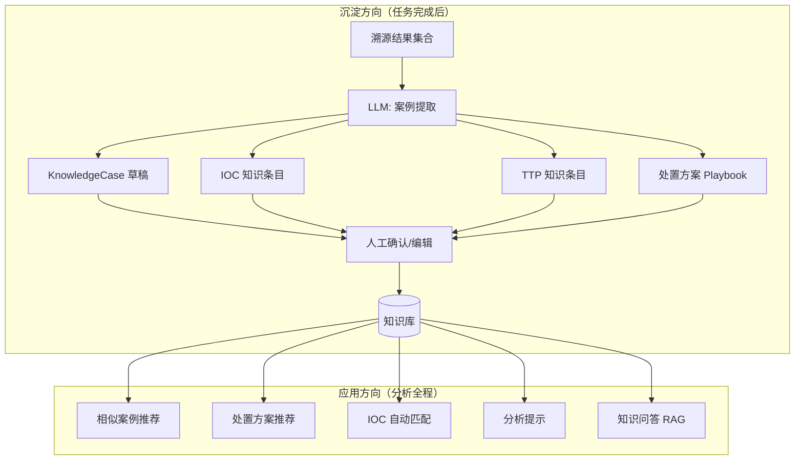
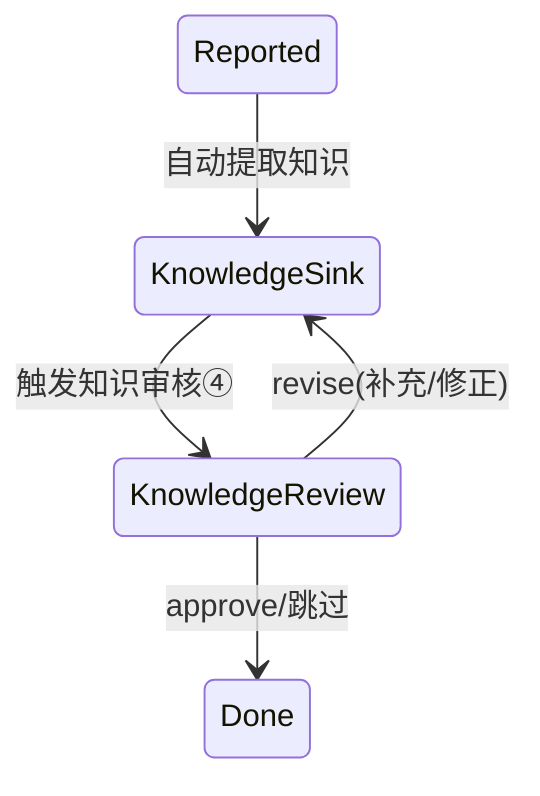
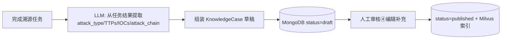
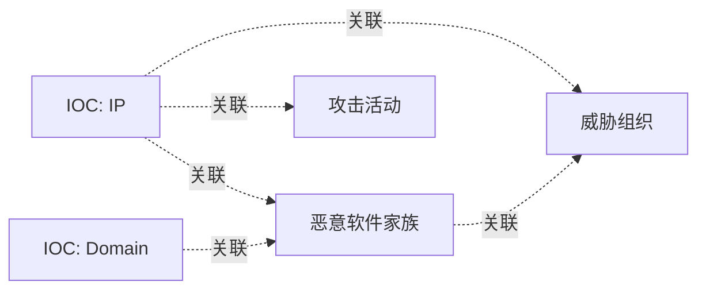
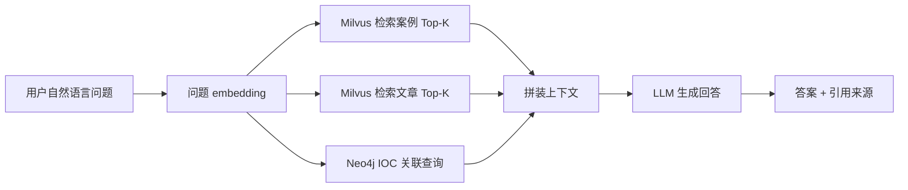
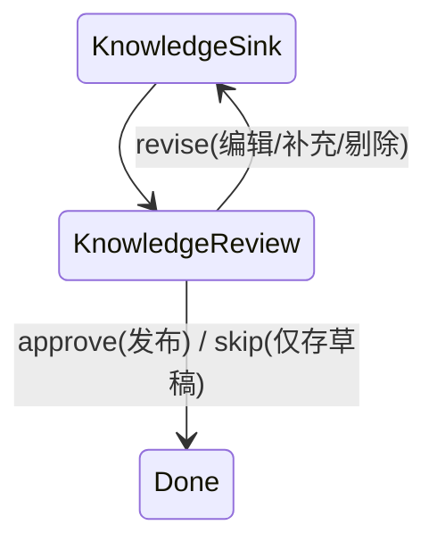

# 阶段三技术设计 — 知识沉淀与智能应用

> **阶段**: P3 · 知识沉淀与智能应用  
> **版本**: v1.0  
> **日期**: 2026-07-22  
> **依据**: [00_overview_and_roadmap.md](00_overview_and_roadmap.md)、[02_phase2_design.md](02_phase2_design.md)、[traceback_system_prd.md](../traceback_system_prd.md) §4.2.7、§4.2.8  
> **状态**: 待评审（评审门 G3）  
>  
> 本阶段建设知识闭环：分析结果自动沉淀为知识库，知识库反过来驱动智能推荐与问答，实现「越用越智能」的差异化优势。

---

## 1. 阶段目标与范围

### 1.1 目标

1. **知识沉淀**：完成溯源任务后自动提取案例/IOC/TTP/处置方案，形成四大知识库 + 知识文章库。
2. **知识应用**：在分析全程注入知识能力——相似案例推荐、处置方案推荐、IOC 自动匹配、分析提示、知识问答。
3. **闭环验证**：完成一次溯源 → 自动沉淀 → 下次同类事件自动命中推荐。

### 1.2 范围边界

| 类型 | 内容 |
|------|------|
| **做** | 知识管理智能体；知识案例库（自动提取 F-007-01/人工编辑/分类/检索 F-007-02~04）；IOC 知识库（F-007-05，Neo4j 图谱）；TTP 知识库（F-007-06，关联 MITRE）；处置方案库（F-007-07，Playbook）；知识文章库（F-007-08~09）；向量检索 + RAG；相似案例推荐（F-008-01）、处置方案推荐（F-008-02）、IOC 自动匹配（F-008-03）、分析提示（F-008-05）、知识问答（F-008-04）。 |
| **不做（推迟）** | 知识评价/点赞/统计/导入导出（F-007-10~12，P4 或后续）；多租户隔离（P4）；生产级性能压测（P4）。 |
| **依赖前置** | P2 归因结果、Milvus 向量库（P2 已引入种子案例，P3 替换为真实案例库）。 |

### 1.3 验收标准

| 项 | 标准 | 方式 |
|----|------|------|
| 案例自动提取 | 完成溯源任务后自动生成草稿案例，关键特征（攻击类型/TTP/IOC/处置）提取完整 | 功能+专家评审 |
| 相似案例推荐 | 新事件自动推荐相似案例，Top3 命中率 > 60% | 评测 |
| 处置方案推荐 | 按攻击类型推荐 Playbook，match_score 有效 | 功能测试 |
| IOC 自动匹配 | 分析时自动匹配知识库 IOC，命中标注 | 功能测试 |
| 知识问答 | 自然语言查询知识库，回答相关案例/处置 | 功能测试 |

---

## 2. 知识管理智能体设计

### 2.1 智能体职责

知识管理智能体在编排流程中承担**双向**职责：

- **沉淀方向**（任务结束节点）：从分析结果提取知识条目入库。
- **应用方向**（分析各阶段）：从知识库检索注入上下文。



### 2.2 编排集成

`TracebackState` 增量：

```python
class TracebackState(TypedDict):
    # ... P1/P2 字段 ...
    knowledge_suggestion: dict | None     # 注入的相似案例/处置/提示
    pending_knowledge: dict | None        # 待沉淀的知识草稿
    stage: Literal[..., "reported", "knowledge_review", "done"]
```

状态机在 `Reported` 后新增 `KnowledgeSink` 与 `KnowledgeReview` 节点：



知识应用则在 `CollectingEvidence`/`TimelineBuilt`/`Attributing` 等节点旁路注入，不新增状态，作为上下文增强。

---

## 3. 知识库设计（五大库）

### 3.1 知识案例库（MongoDB + Milvus）

对齐 PRD §6.2.6 `KnowledgeCase`。存储拆分：
- MongoDB 存完整案例文档（结构化字段 + Markdown 描述）。
- Milvus 存案例 embedding，由 `attack_type + ttps + iocs + description` 拼接生成，用于相似检索。

**自动提取流程**（F-007-01）：



案例状态机：`draft → published → archived`，仅 `published` 入 Milvus 索引参与推荐。

### 3.2 IOC 知识库（Neo4j 图谱）

对齐 PRD §6.2.7 `IOCKnowledge`。用 Neo4j 构建关系图谱：



图模型节点：`IOC`、`MalwareFamily`、`ThreatActor`、`Campaign`、`Case`。边表示关联关系。

**IOC 自动匹配**（F-008-03）：分析阶段从证据提取所有 IOC，批量查询 Neo4j，命中则标注关联的家族/组织/案例，注入归因上下文（增强 P2 归因特征）。

### 3.3 TTP 知识库（PostgreSQL + MITRE 关联）

对齐 PRD §6.2.6 的 `ttps` 字段与 F-007-06。表结构：

```sql
CREATE TABLE ttp_knowledge (
    ttp_id           TEXT PRIMARY KEY,       -- 如 T1566.001
    mitre_tactic     TEXT NOT NULL,
    mitre_technique  TEXT NOT NULL,
    name             TEXT NOT NULL,
    description      TEXT,
    detection_tips   JSONB DEFAULT '[]',     -- 检测建议
    response_tips    JSONB DEFAULT '[]',     -- 处置建议
    source_cases     JSONB DEFAULT '[]',     -- 引用此 TTP 的案例
    create_time      TIMESTAMPTZ DEFAULT now()
);
```

TTP 知识库以 MITRE ATT&CK enterprise JSON 为基底（P1 已加载白名单），P3 增补检测/处置 tips 与案例反向引用。攻击链标注 TTP 时即可关联知识库给出处置提示。

### 3.4 处置方案库（PostgreSQL）

对齐 PRD §6.2.8 `ResponsePlaybook` / `ResponseStep`。

```sql
CREATE TABLE response_playbooks (
    playbook_id    TEXT PRIMARY KEY,
    name           TEXT NOT NULL,
    description    TEXT,
    attack_type    TEXT NOT NULL,
    steps          JSONB NOT NULL,           -- ResponseStep[]
    prerequisites  JSONB DEFAULT '[]',
    applicable_assets JSONB DEFAULT '[]',
    effectiveness  REAL DEFAULT 0,
    side_effects   JSONB DEFAULT '[]',
    author         TEXT,
    version        TEXT DEFAULT '1.0',
    usage_count    INT DEFAULT 0,
    success_rate   REAL DEFAULT 0,
    create_time    TIMESTAMPTZ DEFAULT now()
);
CREATE INDEX idx_playbook_attack_type ON response_playbooks(attack_type);
```

**处置方案推荐**（F-008-02）：按 `attack_type` 检索 + TTP 重叠度排序，返回 `match_score`、`usage_count`、`success_rate`。

### 3.5 知识文章库（MongoDB + Milvus）

对齐 PRD §6.2.9 `KnowledgeArticle`。分类：方法论/技巧/工具使用/最佳实践。文章内容 Markdown，embedding 入 Milvus 供知识问答检索。

---

## 4. 向量检索与 RAG 设计

### 4.1 Embedding 策略

| 知识类型 | embedding 文本组成 | 用途 |
|---------|-------------------|------|
| 案例库 | attack_type + ttps + iocs + description | 相似案例推荐 |
| 文章库 | title + tags + content 摘要 | 知识问答检索 |
| 处置方案 | attack_type + ttps + description | 处置推荐（可选用向量，主用 attack_type 精确匹配） |

Embedding 模型：P3 默认用 DeepSeek embedding 或 bge-large-zh（本地可控），维度对齐 Milvus collection。

### 4.2 RAG 问答流程（F-008-04）



回答强制附引用（案例 ID / 文章 ID / IOC ID），无相关结果时明确回答「知识库无相关记录」而非编造。

### 4.3 检索质量保障

- **混合检索**：向量相似 + 关键词（MongoDB 全文）+ 标签精确匹配，加权融合。
- **重排序**：Top-K 召回后用 LLM 或 cross-encoder 重排，提升 Top3 命中率。
- **评测集**：构建 30 条问答黄金样本，评测 Top3 命中率 > 60%。

---

## 5. 知识应用注入设计

### 5.1 注入点与能力对照

| 分析阶段 | 注入能力 | 来源库 | 对应功能 |
|---------|---------|--------|---------|
| 证据收集 | IOC 自动匹配 | IOC 库 | F-008-03 |
| 时间线/攻击链 | 相似案例推荐 + 分析提示 | 案例库/TTP 库 | F-008-01、F-008-05 |
| 攻击链完成 | 处置方案推荐 | Playbook 库 | F-008-02 |
| 归因 | IOC 关联增强（组织/家族） | IOC 库 | 增强 P2 归因 |
| 全程 | 知识问答（用户主动） | 全库 RAG | F-008-04 |

### 5.2 注入机制

知识应用作为**旁路增强**，不改变 P1/P2 主流程状态机，仅在智能体 prompt 上下文中追加 `knowledge_suggestion` 字段：

```python
# 知识管理智能体 - 应用侧
class KnowledgeAgent(AgentBase):
    async def suggest_for_stage(self, state, stage) -> dict:
        if stage == "collecting":
            return {"ioc_matches": await self._match_iocs(state)}
        if stage in ("timeline_built", "chain_analyzed"):
            return {
                "similar_cases": await self._similar_cases(state),
                "analysis_tips": await self._ttp_tips(state)
            }
        if stage == "chain_analyzed":
            return {"playbooks": await self._recommend_playbooks(state)}
```

编排节点在调用主智能体前，先调用 `KnowledgeAgent.suggest_for_stage` 注入上下文。

### 5.3 相似案例推荐算法

```
query_embedding = embed(attack_type + ttps + iocs)
candidates = Milvus.search(query_embedding, top_k=10)
# 重排：相似度 * 0.6 + TTP重叠率 * 0.3 + 同攻击类型 * 0.1
reranked = rerank(candidates, query_features)
return reranked[:3] with matched_features
```

---

## 6. 知识沉淀详细设计

### 6.1 自动提取（F-007-01）

任务完成（报告审核通过）后，`KnowledgeSink` 节点调用 LLM 从 `TracebackState` 提取：

| 提取目标 | 来源 | 输出 |
|---------|------|------|
| 案例草稿 | 任务全貌 | KnowledgeCase(status=draft) |
| IOC 条目 | 攻击链 attacker_ips/domains + 证据 IOC | IOCKnowledge[] |
| TTP 条目 | 攻击链 technique_id | TTP 反向引用更新 |
| 处置方案 | 报告处置建议章节 | ResponsePlaybook(status=draft) |

提取采用结构化 schema 输出，校验失败重试。所有条目初始为 `draft`，需人工审核④确认后才 `published` 入索引。

### 6.2 人工审核④



审核界面支持：编辑案例内容、剔除误提取 IOC、补充经验笔记（F-007-08）、调整分类标签、关联已有案例。

### 6.3 案例分类与检索

- **分类**：勒索病毒 / APT / 数据泄露 / 钓鱼 / 横向移动 / 其他（F-007-03）。
- **检索**（F-007-04）：全文检索（MongoDB text）+ 标签筛选 + 向量相似 + 时间范围。

---

## 7. 数据模型汇总

### 7.1 存储分布

| 知识库 | 存储 | 对齐 PRD 模型 |
|--------|------|--------------|
| 知识案例 | MongoDB + Milvus | KnowledgeCase §6.2.6 |
| IOC 知识 | Neo4j + PG(元数据) | IOCKnowledge §6.2.7 |
| TTP 知识 | PostgreSQL | §6.2.6 ttps + F-007-06 |
| 处置方案 | PostgreSQL | ResponsePlaybook §6.2.8 |
| 知识文章 | MongoDB + Milvus | KnowledgeArticle §6.2.9 |

### 7.2 Milvus Collections

| Collection | 维度 | 内容 |
|-----------|------|------|
| `case_embeddings` | 1024 | 真实案例（替换 P2 种子） |
| `article_embeddings` | 1024 | 知识文章 |

### 7.3 Neo4j 图谱

节点标签：`IOC`、`MalwareFamily`、`ThreatActor`、`Campaign`、`Case`、`Article`。关系类型：`RELATES_TO`、`USES_TTP`、`PART_OF`、`REFERENCED_BY`。

---

## 8. API 设计（P3 知识管理接口，对齐 PRD §7.1.4）

### 8.1 案例管理

| 方法 | 路径 | 说明 |
|------|------|------|
| POST | `/api/v1/knowledge/cases` | 创建案例（从任务转化） |
| GET | `/api/v1/knowledge/cases` | 案例列表（分类/标签筛选） |
| GET | `/api/v1/knowledge/cases/{id}` | 案例详情 |
| PUT | `/api/v1/knowledge/cases/{id}` | 编辑案例 |
| POST | `/api/v1/knowledge/cases/{id}/publish` | 发布案例 |
| POST | `/api/v1/knowledge/cases/search-similar` | 相似案例检索 |

### 8.2 IOC 知识库

| 方法 | 路径 | 说明 |
|------|------|------|
| GET | `/api/v1/knowledge/iocs?ioc_type=&value=` | 查询 IOC |
| POST | `/api/v1/knowledge/iocs/batch-query` | 批量查询（分析时自动匹配用） |
| POST | `/api/v1/knowledge/iocs` | 添加 IOC |

### 8.3 处置方案库

| 方法 | 路径 | 说明 |
|------|------|------|
| GET | `/api/v1/knowledge/playbooks?attack_type=` | 列表 |
| GET | `/api/v1/knowledge/playbooks/{id}` | 详情 |
| POST | `/api/v1/knowledge/playbooks` | 创建 |
| POST | `/api/v1/knowledge/playbooks/recommend` | 推荐 |

### 8.4 知识文章与问答

| 方法 | 路径 | 说明 |
|------|------|------|
| POST | `/api/v1/knowledge/articles` | 创建文章 |
| GET | `/api/v1/knowledge/articles` | 列表 |
| POST | `/api/v1/knowledge/articles/search` | 搜索 |
| POST | `/api/v1/knowledge/qa` | 知识问答（RAG） |

---

## 9. LLM 调用与评测

### 9.1 P3 新增 LLM 调用

| 调用点 | 输出 schema |
|--------|------------|
| 案例自动提取 | KnowledgeCaseDraft + IOC[] + PlaybookDraft |
| 知识问答生成 | Answer + Citations[] |
| 分析提示生成 | AnalysisTips |

### 9.2 评测

| 评测集 | 指标 |
|--------|------|
| 相似案例推荐 | Top3 命中率 > 60% |
| 知识问答 | 答案相关性 + 引用准确率 |
| 案例提取 | 关键字段提取完整度 > 85% |

---

## 10. 非功能性设计（P3 增量）

| 维度 | P3 要求 | 实现 |
|------|---------|------|
| 检索性能 | 向量检索 < 500ms | Milvus 索引 + 重排限 Top10 |
| 一致性 | 案例发布后立即可检索 | 发布时同步写 Milvus，删除/归档时同步移除 |
| 幂等 | 重复沉淀不产生重复条目 | 按 (source_task_id, type) 去重 |
| 降级 | 知识库不可用不阻塞主流程 | 知识注入失败则跳过，主流程继续 |

---

## 11. 测试策略（P3 增量）

| 层次 | 范围 |
|------|------|
| 单元 | 案例提取、IOC 图谱查询、推荐算法、RAG 拼装 |
| 集成 | Milvus/Neo4j testcontainers、知识沉淀→检索闭环 |
| 端到端 | 完成溯源→自动沉淀→新事件命中推荐（UAT 闭环用例） |
| 评测 | 相似案例 Top3 > 60%、问答引用准确率 |

---

## 12. 里程碑与交付物

| Sprint | 里程碑 | 交付物 | 完成标准 |
|--------|--------|--------|---------|
| S8 (W16-18) | M8 知识库建设 | 五大库 schema、案例/IOC/TTP/Playbook/文章 CRUD、自动提取 | 案例提取完整度 > 85% |
| S9 (W19-20) | M9 检索与问答 | Milvus/Neo4j 集成、RAG 问答、知识审核④ | 相似案例 Top3 > 60% |
| S10 (W21-22) | M10 智能应用 | 四类推荐注入编排、闭环验证 | **G3 评审门** |

---

## 13. 风险与对策

| 风险 | P3 影响 | 对策 |
|------|---------|------|
| 案例提取质量差 | 高 | LLM schema 约束 + 人工审核④ + 复用 P2 评测经验 |
| 检索召回不准 | 中 | 混合检索 + 重排 + 评测集调优 |
| 知识库膨胀 | 低 | 归档机制 + 向量索引分片（P4 优化） |
| Neo4j 运维复杂 | 中 | P3 单实例够用，P4 再考虑高可用 |
| RAG 幻觉 | 高 | 强制引用来源，无结果时拒答 |

---

## 14. 评审检查清单（G3）

请重点评审：

1. **五大知识库存储分布**：案例/文章(Mongo+Milvus)、IOC(Neo4j+PG)、TTP/Playbook(PG)，是否合理？
2. **知识沉淀闭环**：任务完成→自动提取草稿→人工审核④→发布入索引，是否认可？
3. **知识应用旁路注入**：不改动主流程状态机，仅增强 prompt 上下文，是否合适？
4. **IOC 用 Neo4j 图谱**：构建 IOC-家族-组织-活动关系，增强归因，是否引入？
5. **RAG 问答强制引用 + 无结果拒答**：防幻觉策略是否认可？
6. **范围**：知识评价/点赞/统计/导入导出推迟到 P4 或后续，是否可接受？

确认后进入阶段四设计（企业级生产化与运营）。
