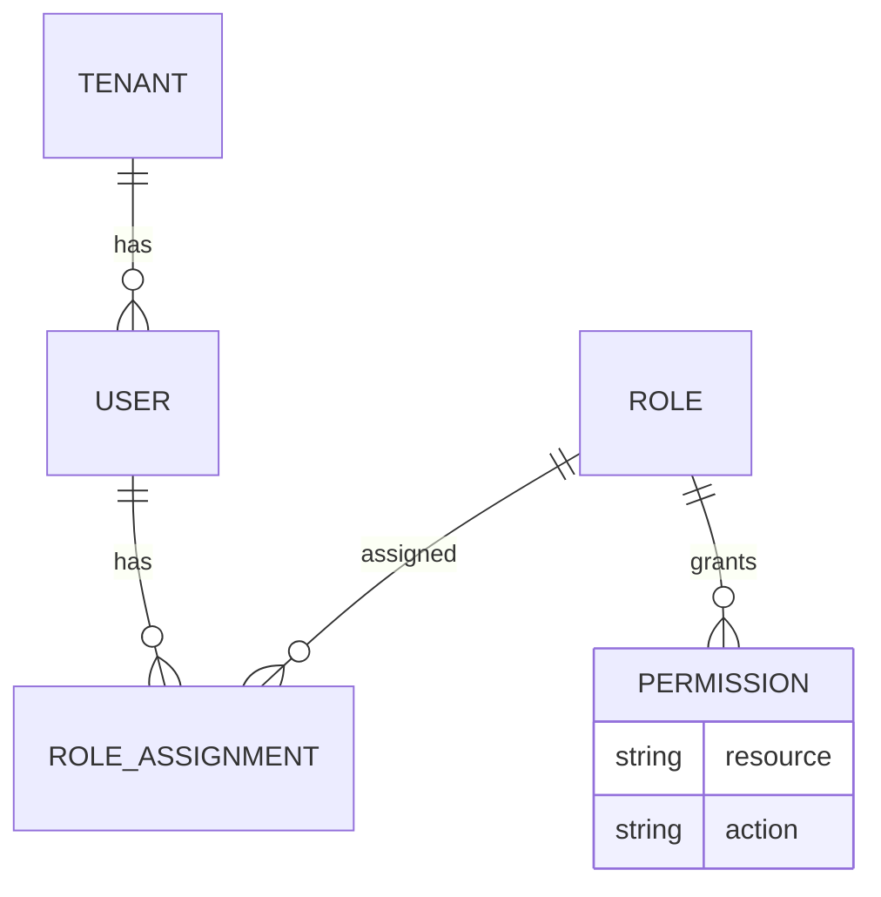
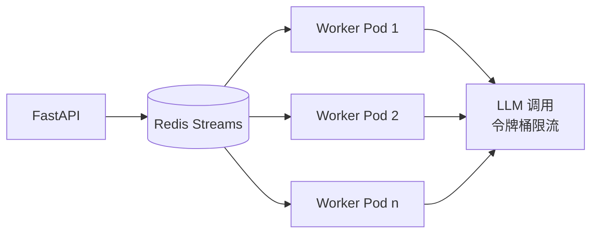
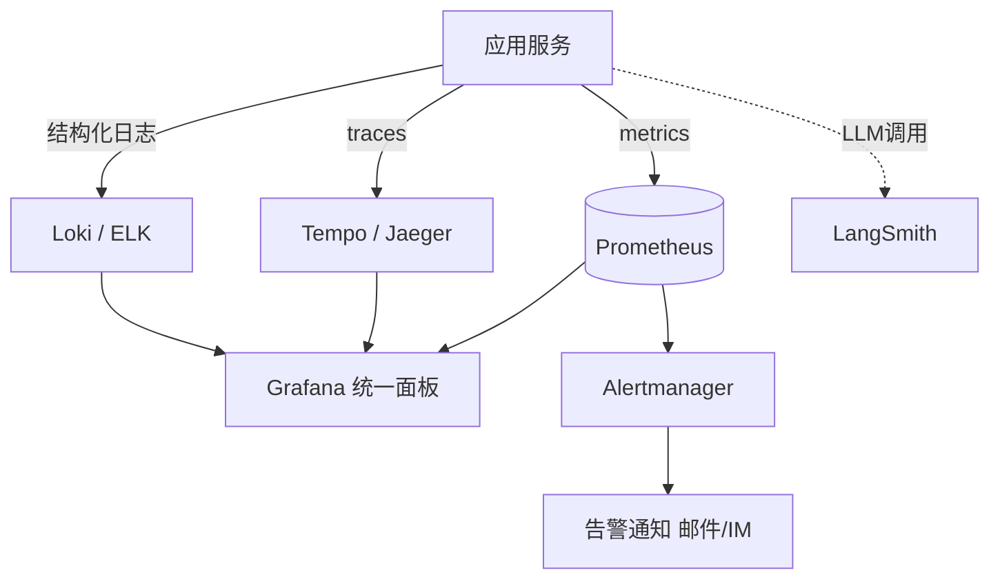
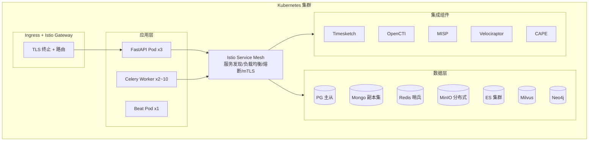

# 阶段四技术设计 — 企业级生产化与运营

> **阶段**: P4 · 企业级生产化与运营  
> **版本**: v1.0  
> **日期**: 2026-07-22  
> **依据**: [00_overview_and_roadmap.md](00_overview_and_roadmap.md)、[03_phase3_design.md](03_phase3_design.md)、[traceback_system_prd.md](../traceback_system_prd.md) §5、§9.16.5  
> **状态**: 待评审（评审门 G4 · 上线）  
>  
> 本阶段将前三阶段的功能完整系统升级为生产可用、企业级运营平台：多租户隔离、安全认证、性能并发、可观测、K8s 高可用部署与合规。

---

## 1. 阶段目标与范围

### 1.1 目标

1. **企业级安全**：多租户数据隔离、RBAC、LDAP/OAuth2 认证、操作审计、数据加密。
2. **生产级性能**：满足 NFR 全部指标（10 并发任务、100 万日志、30 分钟内完成）。
3. **可观测性**：日志、指标、链路追踪、告警四件套。
4. **高可用部署**：K8s + Istio 容器化部署，99.5% 可用性，故障恢复 < 30 分钟。
5. **合规与运营**：License 合规审查、安全扫描、报告模板扩展、协作分析。

### 1.2 范围边界

| 类型 | 内容 |
|------|------|
| **做** | 多租户与 RBAC（SEC-001~006）；LDAP/OAuth2 认证；操作审计日志；TLS 传输 + AES-256 存储；性能优化（并发/缓存/异步/批处理）；OpenTelemetry + Prometheus + Grafana + LangSmith 可观测；K8s + Istio 部署；高可用与灾备；安全扫描与 License 合规；报告模板扩展（F-006-05/06）；任务协作（F-001-08）；知识评价/统计/导入导出（F-007-10~12）。 |
| **不做（后续迭代）** | 攻击模拟 F-004-07（CALDERA 集成，后续版本）；跨集群联邦；商业化计费。 |
| **依赖前置** | P1~P3 全部功能就绪。 |

### 1.3 验收标准（对齐 PRD §5、§8）

| 维度 | 标准 |
|------|------|
| 性能 NFR-001~006 | 任务创建 < 2s、证据收集 < 5min、时间线 < 3min、完整分析 < 30min、并发 ≥ 10、单任务 ≤ 100 万日志 |
| 可用性 NFR-007~009 | ≥ 99.5%、故障恢复 < 30min、数据持久 100% |
| 安全 SEC-001~006 | 认证/授权/加密/审计/隔离/API Token 全部达标 |
| 质量 | 代码覆盖率 > 80%、无高危漏洞、文档齐全 |
| UAT | UAT-001/002/003 全部通过 |

---

## 2. 多租户与安全设计

### 2.1 多租户数据隔离（SEC-005）

采用**共享数据库 + tenant_id 行级隔离**，所有业务表增加 `tenant_id` 字段，通过中间件强制注入查询条件。

```python
# core/tenant.py
class TenantContext:
    """请求级租户上下文"""
    tenant_id: str | None = None

# 仓库层基类强制 tenant 过滤
class TenantScopedRepo:
    async def query(self, filters):
        filters["tenant_id"] = TenantContext.tenant_id  # 强制注入
        return await self._raw_query(filters)
```

**MinIO 隔离**：每租户独立 bucket 前缀 `tenant-{id}/`。  
**MongoDB/Neo4j 隔立**：文档/节点带 `tenant_id`，查询注入。  
**LangGraph checkpoint**：`thread_id` 含 `tenant_id` 前缀。

### 2.2 RBAC 权限模型（SEC-002）



预置角色（对齐 PRD §2.1 用户画像）：

| 角色 | 权限 |
|------|------|
| 安全运营工程师 | 创建/查看任务、执行分析、导出报告 |
| 安全分析师 | 运营工程师 + 时间线/攻击链审核、知识编辑 |
| 应急响应专家 | 分析师 + 任务分配、跨团队协作 |
| 安全研究员 | 分析师 + 归因审核、IOC/案例管理 |
| 安全管理者 | 全租户只读 + 报告、统计查看 |
| 系统管理员 | 租户/用户/角色管理 |

权限粒度：`resource:action`（如 `task:create`、`case:publish`、`attribution:review`）。API 层装饰器校验。

### 2.3 认证（SEC-001）

- **LDAP**：企业内部 AD/LDAP 集成，`ldap3` 校验凭据。
- **OAuth2**：支持对接企业 SSO（Authorization Code 流）。
- **本地账户**：兜底，bcrypt 存储。
- **Token**：JWT（access + refresh），access 30min、refresh 7d。

### 2.4 API 安全（SEC-006）

- 所有 API 需 JWT Token 认证。
- **防重放**：JWT 携带 `jti`，Redis 缓存已用 jti，5 分钟窗口内拒绝重复。
- 限流：per-tenant 限流（如 100 req/min），保护后端。
- 输入校验：Pydantic 严格校验，查询 DSL 白名单字段（P1 已建立）。

### 2.5 数据加密（SEC-003）

| 场景 | 方案 |
|------|------|
| 传输 | 全站 TLS 1.3，内部服务间 mTLS（Istio） |
| 存储 | 敏感字段（资产 IP、用户账号）AES-256-GCM 列级加密 |
| 凭据 | 密钥统一由 KMS/Vault 管理，不落配置文件 |
| 对象存储 | MinIO 服务端加密 SSE-S3 |

### 2.6 操作审计（SEC-004）

所有写操作与敏感读操作记录审计日志：

```sql
CREATE TABLE audit_logs (
    log_id      BIGSERIAL PRIMARY KEY,
    tenant_id   TEXT NOT NULL,
    user_id     TEXT NOT NULL,
    action      TEXT NOT NULL,         -- create_task/review/export_report...
    resource    TEXT NOT NULL,
    resource_id TEXT,
    detail      JSONB,                 -- 变更前后
    ip          TEXT,
    user_agent  TEXT,
    log_time    TIMESTAMPTZ NOT NULL DEFAULT now()
);
CREATE INDEX idx_audit_tenant_time ON audit_logs(tenant_id, log_time);
```

审计日志独立存储（可投递 Elasticsearch），保留 1 年，不可篡改（追加写）。

---

## 3. 性能优化设计

### 3.1 并发任务处理（NFR-005）



- **Worker 水平扩展**：Celery Worker K8s Deployment，按队列长度 HPA 自动扩缩（2~10 副本）。
- **并发控制**：每租户最大并发任务数可配（默认 10），超出的排队。
- **LLM 限流**：令牌桶控制 LLM 并发，避免触发 DeepSeek 限流，跨 worker 共享计数（Redis）。

### 3.2 大数据量处理（NFR-006）

| 场景 | 优化 |
|------|------|
| 100 万日志 | 流式分页拉取 + 分批送 LLM（map-reduce）+ 按 importance 裁剪 |
| 证据存储 | 批量写入 MinIO/Mongo，避免逐条 |
| 时间线 | 事件聚合（同类型同资产合并）后再排序 |
| 查询 | PG 索引优化 + Mongo 复合索引 + ES 分片 |

### 3.3 缓存策略

| 缓存对象 | 存储 | TTL |
|---------|------|-----|
| ATT&CK 白名单/TTP 知识 | 进程内存 + Redis | 1h |
| IOC 查询结果 | Redis | 10min |
| 任务进度 | Redis | 30s |
| 报告模板渲染片段 | 内存 | 永久 |

### 3.4 异步与削峰

- 长耗时操作（CAPE/Volatility/报告导出）全部 Celery 异步。
- Redis Streams 削峰，队列堆积告警。
- API 层非阻塞，分析进度走 SSE/WebSocket 推送替代轮询。

---

## 4. 可观测性设计（PRD §5.5）

### 4.1 三件套架构



### 4.2 日志（OBS-001）

- `structlog` 结构化 JSON 日志，含 `trace_id`、`tenant_id`、`task_id`。
- 分类：运行日志、用户操作日志（审计）、错误日志。
- 统一采集到 Loki/ELK，按租户隔离检索。

### 4.3 指标（OBS-002）

Prometheus 指标：

| 指标 | 类型 | 说明 |
|------|------|------|
| `traceback_tasks_total` | counter | 任务计数（按 stage/tenant） |
| `traceback_stage_duration_seconds` | histogram | 各阶段耗时 |
| `traceback_active_tasks` | gauge | 当前并发任务数 |
| `traceback_llm_calls_total` | counter | LLM 调用（按 agent/状态） |
| `traceback_llm_tokens` | counter | token 消耗 |
| `traceback_adapter_errors` | counter | 适配器错误（按 source） |
| `traceback_knowledge_hits` | counter | 知识推荐命中 |

Grafana 预置仪表盘：系统总览、租户视图、智能体性能、知识库运营。

### 4.4 链路追踪（OBS-003）

- OpenTelemetry 自动埋点：FastAPI 请求、DB 查询、适配器调用、LLM 调用。
- 单次溯源任务全链路 trace，串联 API → Worker → 智能体 → 适配器 → LLM。
- LangSmith 专项追踪 LLM 智能体调用链与 prompt（P1 已引入，P4 正式化）。

### 4.5 告警（OBS-004）

Alertmanager 规则：

| 告警 | 触发 |
|------|------|
| 任务失败率高 | 5min 失败率 > 10% |
| 阶段超时 | 单阶段超 NFR 上限 |
| 队列堆积 | Redis 队列 > 50 |
| 适配器不可用 | health_check 连续失败 |
| LLM 限流 | 429 持续 |
| 资源紧张 | CPU/内存 > 80% |

通知渠道：邮件、企业 IM（复用 stock_agent 的 wechat_notifier 模式）。

---

## 5. K8s 部署与高可用

### 5.1 部署架构（PRD §9.16.5）



### 5.2 高可用（NFR-007、NFR-008）

| 组件 | HA 方案 |
|------|---------|
| FastAPI | 3 副本，无状态，负载均衡 |
| Celery Worker | 2~10 副本 HPA |
| PostgreSQL | 主从复制 + Patroni 自动故障转移 |
| MongoDB | 3 节点副本集 |
| Redis | 哨兵或集群模式 |
| MinIO | 分布式多节点 |
| 智能体状态 | checkpoint 持久化 PG，Worker 重启可恢复 |

故障恢复 < 30 分钟：Patroni 自动主从切换（< 1min）+ Worker 重试 + checkpoint 恢复。

### 5.3 数据持久与灾备（NFR-009）

- PG/Mongo 定时全量 + WAL/Oplog 增量备份，异地存储。
- MinIO 跨节点纠删码。
- 备份恢复演练，RPO < 15min，RTO < 30min。

### 5.4 CI/CD

- Git → CI（lint + mypy + 单测 + 集成测 + 安全扫描）→ 构建镜像 → CD（ArgoCD 滚动发布）。
- 蓝绿/金丝雀发布，支持快速回滚。

---

## 6. 合规与安全扫描

### 6.1 License 合规（PRD §9.17）

| 组件 | License | 处置 |
|------|---------|------|
| MISP/Velociraptor/TheHive/Suricata | AGPL/GPL | 独立服务部署，仅 API 调用，不并入代码仓 |
| Timesketch/OpenCTI/Volatility3 | Apache-2.0 | 可深度集成 |
| Zeek | BSD-3 | 可深度集成 |

P4 上线前用 `pip-licenses` + 人工审查，输出合规清单，确保无传染性 License 进入主代码。

### 6.2 安全扫描

- **SAST**：Bandit（Python 静态扫描）
- **依赖扫描**：pip-audit / Dependabot，CVE 监控
- **容器扫描**：Trivy 扫描镜像漏洞
- **DAST**：上线前外部渗透测试
- 目标：无高危漏洞（PRD §8.3）

---

## 7. 报告模板扩展与协作

### 7.1 报告模板管理（F-006-01、F-006-05、F-006-06）

- 模板管理界面：CRUD Jinja2 模板，支持自定义章节。
- 报告存档：发布报告自动存入案例库关联。
- 报告分享：生成带 Token 的临时分享链接，支持协作批注。

### 7.2 任务协作（F-001-08）

- 任务支持多分析师协作，记录每人操作。
- 协作通知：审核节点通知相关人。
- 评论/批注：任务内讨论，关联到具体证据/事件。

### 7.3 知识运营功能（F-007-10~12）

- 知识点赞/评价/反馈。
- 知识贡献统计、热门排行。
- 知识库批量导入导出（STIX 2.1 格式互操作）。

---

## 8. 配置与多环境

| 环境 | 用途 | 配置 |
|------|------|------|
| dev | 开发 | Docker Compose（P1 模式） |
| test | CI/集成测试 | testcontainers |
| staging | 预发布 | 小规模 K8s |
| prod | 生产 | 完整 K8s + HA |

配置管理：Helm values + 环境变量 + ConfigMap，敏感信息走 Vault/K8s Secret。

---

## 9. 非功能性验收矩阵

| NFR | 要求 | P4 实现验证 |
|-----|------|------------|
| NFR-001 任务创建 < 2s | API 直写 PG | 压测 |
| NFR-002 证据收集 < 5min | 并行适配器 + 分批 | 压测 10 万日志 |
| NFR-003 时间线 < 3min | map-reduce + 裁剪 | 压测 |
| NFR-004 完整 < 30min | 全链路异步 | 端到端压测 |
| NFR-005 并发 ≥ 10 | Worker HPA + 限流 | 并发压测 |
| NFR-006 ≤ 100 万日志 | 流式 + 裁剪 | 大数据量测试 |
| NFR-007 ≥ 99.5% | K8s HA | 上线观测 |
| NFR-008 恢复 < 30min | Patroni + checkpoint | 故障演练 |
| NFR-009 持久 100% | 备份 + 持久化 | 演练 |
| SEC-001~006 | 全部达标 | 安全扫描 + 渗透 |

---

## 10. 测试策略（P4 增量）

| 层次 | 范围 |
|------|------|
| 性能压测 | Locust 模拟 10 并发任务、100 万日志 |
| 故障演练 | Chaos Engineering：杀 Pod、断适配器、限 LLM |
| 安全测试 | SAST/DAST/容器扫描 + 渗透测试 |
| HA 演练 | 主从切换、备份恢复 |
| UAT | UAT-001/002/003 在生产级环境通过 |

---

## 11. 里程碑与交付物

| Sprint | 里程碑 | 交付物 | 完成标准 |
|--------|--------|--------|---------|
| S11 (W23-24) | M11 安全与多租户 | RBAC、LDAP/OAuth2、审计、加密、tenant 隔离 | 安全扫描通过 |
| S12 (W25-26) | M12 性能与可观测 | 并发优化、缓存、OTel+Prom+Grafana、告警 | NFR 性能指标达标 |
| S13 (W27-28) | M13 部署与上线 | K8s+Istio 部署、HA、灾备、CI/CD、合规审查 | UAT 全通过、**G4 评审门：上线** |

---

## 12. 风险与对策

| 风险 | P4 影响 | 对策 |
|------|---------|------|
| 性能不达标 | 高 | 分阶段压测，瓶颈定位（LLM/DB/适配器）逐项优化 |
| 多租户改造回归 | 中 | 渐进式加 tenant_id，租户过滤中间件 + 测试覆盖 |
| K8s 运维复杂 | 中 | Istio 简化服务治理，监控告警兜底 |
| 安全合规延期 | 中 | 安全扫描前置到每 Sprint，不留末尾 |
| License 误用 | 高 | 上线前合规审查清单，AGPL 组件严守 API 隔离 |

---

## 13. 评审检查清单（G4 · 上线）

请重点评审：

1. **多租户方案**：共享数据库 + tenant_id 行级隔离（含 MinIO/Mongo/Neo4j），是否认可？
2. **RBAC 角色**：6 个预置角色对齐 PRD 用户画像，是否覆盖业务需要？
3. **认证**：LDAP + OAuth2 SSO + JWT（jti 防重放），是否符合企业现状？
4. **性能目标**：Worker HPA 2~10 副本 + LLM 令牌桶 + 流式分批，能否支撑 10 并发/100 万日志？
5. **可观测**：OTel + Prometheus + Grafana + Loki + LangSmith 四件套，是否齐全？
6. **部署**：K8s + Istio + Patroni 主从 + 副本集，HA 99.5%，是否同意作为上线目标？
7. **合规**：AGPL 组件独立部署走 API、上线前 License + 安全扫描审查，是否认可？
8. **范围**：攻击模拟（CALDERA）推迟到后续版本，是否可接受？

确认后四阶段设计全部完成，可进入实施阶段。

---

## 14. 四阶段设计总结

| 阶段 | 文档 | 核心交付 | 评审状态 |
|------|------|---------|---------|
| P1 | [01_phase1_design.md](01_phase1_design.md) | MVP 核心溯源流水线 | ✅ 通过 |
| P2 | [02_phase2_design.md](02_phase2_design.md) | 威胁归因与深度取证 | ✅ 通过 |
| P3 | [03_phase3_design.md](03_phase3_design.md) | 知识沉淀与智能应用 | ✅ 通过 |
| P4 | 04_phase4_design.md | 企业级生产化与运营 | ⏳ 待评审 |
| 总纲 | [00_overview_and_roadmap.md](00_overview_and_roadmap.md) | 系统设计 + 路线图 | ✅ 通过 |

G4 通过后，溯源分析系统完成从 PRD 到可实施技术设计的全链路转化，可按 P1→P4 顺序进入开发实施。
